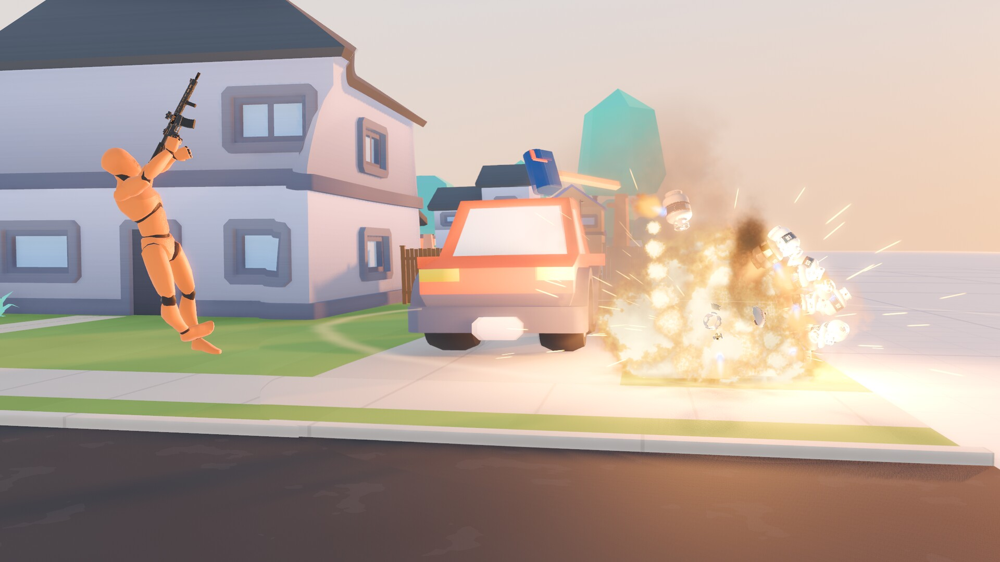
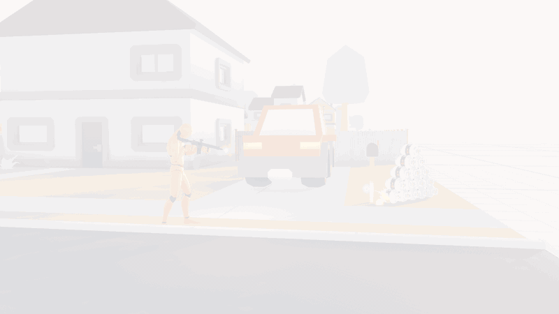

# Propane

A third-person sandbox. Run around a procedurally generated suburb floating in a white void, find the propane tanks,
stacked in groups around the yards, and shoot them. The first shot punctures a tank and it vents fire forever, pushed around by its own jet. The
second shot blows it up, throwing cars, bins, fence panels and you. Clear every tank and a new suburb assembles
around you. There is no health and no score.



Multiplayer is **tank bank**, a free-for-all for 2–5 players: every tank you blow up is banked as a point, and getting
shot (or thrown by a blast) spills your tanks back out for anyone to take. Most banked when the clock runs out wins.

[design/VISION.md](design/VISION.md) is what the game is and must stay. [docs/multiplayer.md](docs/multiplayer.md) gives
tank bank's full rules and how multiplayer is built.

## Download and play

Builds for Windows (x86_64), macOS (Apple Silicon) and Linux (x86_64) are on the
[latest release](https://github.com/talmage89/propane-game/releases/latest).

- **Windows:** extract the ZIP and run `Propane.exe`, keeping all the extracted files together. It is not code
  signed, so Windows SmartScreen may block the first launch: click **More info**, then **Run anyway**.
  Needs a GPU with Vulkan drivers.
- **macOS:** unzip and open `Propane.app`. It is not notarized by Apple, so the first launch is blocked: open
  System Settings > Privacy & Security and click **Open Anyway**. Downloading with
  `gh release download --repo talmage89/propane-game` skips the prompt.
- **Linux:** extract the archive and run `./Propane.x86_64`. Needs a GPU with Vulkan drivers.

Nothing else is needed: each build carries its own .NET runtime.



## Running from source

Requires Godot 4.7.2 (.NET edition) and the .NET 10 SDK.

- First: `make setup` imports the assets and compiles. Run it again after switching branches or pulling. It also
  gives the checkout its own Godot user data folder, `Propane-dev/<folder name>`, in a gitignored `override.cfg`.
- Editor: open `project.godot` and press Play (F5).
- Command line: `make run`. `make` lists the other tasks (tests, a local server, bots, releases); they find Godot on
  `PATH` (`godot-mono` or `godot`) or in `/Applications`, or set `GODOT` to its binary.
- Quality gate: `make lint` verifies C# formatting and rebuilds with warnings as errors. `make check` runs lint,
  then `make test`. Run it before submitting a change. `tools/dev/check_world.sh` prints log tails and keeps its
  scratch directory on failure. GitHub Actions runs the same checks on pushes to `dev`
  and every pull request.

[docs/code-quality.md](docs/code-quality.md) describes the formatting and analyzer baseline and its regression
checks. The gate follows the existing code's style and checks correctness without API design or naming churn.

The game opens maximized on the main menu: Single player, Multiplayer or Quit. In play it captures the mouse; click
the window to recapture it after switching away.

## Multiplayer

Choose Multiplayer, type your name and the server's address (`host` or `host:port`, UDP port 24680 by default), then
create a lobby or join one. Everyone picks a name and any color in the lobby (duplicates are allowed), and whoever
created it sets the match length and starts. **Host on this computer** runs a server inside your game instead; the
lobby then shows the addresses friends can use. Versions with the same major and minor number play together
(0.2.0 with 0.2.5); the server turns away others and says which version it needs.

To play against bots, create a lobby and run `make bots SERVER=host[:port]` (from source; `make bots-stop` stops them).
Starting the game with `-- --connect=host[:port]` skips straight to that server's lobbies.
The message transport is injectable for deterministic tests; see the [transport contract](docs/multiplayer.md#transport-contract)
for fault simulation, disconnect reasons and diagnostics. On Windows or macOS, the
first time you host, allow incoming connections if the system asks.

The dedicated server is the same game run headless: `./Propane.x86_64 --headless -- --server [--port=24680]`.
`tools/server/deploy.sh <ssh host> <dir>` exports it and runs it in Docker on any machine you can reach over ssh;
see [docs/multiplayer.md](docs/multiplayer.md) for hosting and reaching it. Keep a server on the latest release: it
then plays with every patch of that minor version.

## Controls

| Keyboard / mouse | Gamepad (Xbox / PlayStation) | Action |
| --- | --- | --- |
| W A S D | Left stick | Move at the default gait (6 m/s) |
| Shift (hold) | Left stick click (hold) | Sprint forward (9.5 m/s) |
| Space | A / Cross | Jump, including while aiming |
| Mouse | Right stick | Look |
| Left click | Right trigger | Fire (hold for full auto; toggle it in the tuning panel) |
| Right click (hold) | Left trigger (hold) | Aim and creep: upright shouldered walk (1.6 m/s), tight spread; camera stays put |
| F or either mouse thumb button | Right stick click (R3) | Rifle-butt strike: grounded lunge and knockdown; shoves tanks intact |
| R | X / Square | New suburb (single player); reload (multiplayer) |
| Esc | Start / Options | Pause and show the controls (a match keeps running) |
| F1 or ` | — | Tuning panel (live sliders; in a match, the creator's debug build only, and it changes everyone's values) |
| F11 or Alt+Enter | — | Fullscreen |

Aim cancels sprint. Releasing aim with sprint still held restores sprint's target speed on that physics tick,
including after firing. Jumping drops effective aim in the air; held aim returns on landing. Reload owns the weapon
and suppresses aim/fire while leaving the selected movement gait free. Melee cancels sprint/reload, suppresses
jump/aim/fire, lunges forward through windup/contact, and stops during recovery before its cooldown. Right-stick
click puts melee under the looking thumb while leaving movement and the aim/fire triggers available.

The lobby keeps eight quick color presets. **Custom color** opens a live character preview, twelve presets, and hue,
saturation and brightness strips; click or drag a strip, or focus it and use left/right or the left stick. Taps
make fine adjustments; holding accelerates larger moves. Up/down moves between rows and left/right selects a
preset in its row; A / Cross picks it. Hex entry is available for exact colors. The choice is saved between runs,
and old saved palette choices migrate automatically; **Use color** saves and **Cancel** keeps
the previous choice.

Menus work with D-pad or left stick, A / Cross to confirm, and B / Circle to go back. Start / Options opens and
closes pause or the match menu. Left / right changes the focused match length; disabled choices are skipped.
Name and server fields accept their current text with A / Cross, so defaults can be accepted or skipped without
typing. On-screen text entry is supplied by Steam, outside the game. The pause reference and reload hint follow the
last active input device.

Gameplay buttons and stick axes use named actions ([Godot's controller input model](https://docs.godotengine.org/en/stable/tutorials/inputs/controllers_gamepads_joysticks.html)).
Mouse look is displacement; stick look is a rate with separate sensitivity, radial curve and deadzone tuners.
Pause and focus changes clear pending presses and mouse motion, and resample held actions before input resumes.

`src/Player/PlayerState.cs` resolves lifecycle, support, gait and weapon action once per physics tick, from intent and
pre-move floor contact. The accepted jump overrides contact; landing is the first tick that samples contact again.
Held aim is intent, effective aim owns creep/spread, and recent fire only owns ready presentation. Animation blends
walk, jog and sprint over actual speed on one stride clock; the resolved creep gait retains its walk presentation.
A foot modifier plants world-space contacts, steps in the travel direction and adjusts the pelvis to static ground;
remote clips follow displayed snapshot displacement. Jump poses follow latched takeoff, vertical velocity and
impact-scaled landing. See [the locomotion review](docs/locomotion.md) for measurements and captures. The node
facade owns collisions, ammo and lifecycle transitions; the resolver has no scene or engine dependencies.
Rifle and torso sway follow that stride; walk is subtle and aimed creep stays steady. Shots add spring momentum,
with the shoulder absorbing the kick and the camera returning fully. Contact-aware upper-body blends keep hands
attached through stance changes, reload and get-up. See [the motion review](docs/motion.md) for captures and bounds.
A throw immediately clears weapon poses and cancels reload, so get-up cannot restore a pose from before the throw.

## Tuning

Every gameplay and effect dial is a property of `src/Core/Tuning.cs`. Press F1 in game for live sliders. Run from
the editor, **Save** writes them to `res://tuning.tres`, which the game loads on start and which the Godot inspector
can edit. In a downloaded build, Save writes the player's own `tuning.tres` in the game's data folder
(`%APPDATA%\Godot\app_userdata\Propane` on Windows,
`~/Library/Application Support/Godot/app_userdata/Propane` on macOS,
`~/.local/share/godot/app_userdata/Propane` on Linux), which then takes precedence. **Defaults** restores the values
in code. `FixedSeed` (World group) replays one suburb; 0 picks a random one.

Tank piles use weighted formations in both modes: side-laid rows, square tiers, triangular tiers, and upright tight
clusters. The **Tank Piles** tuners control weights and spacing. Each upper tier is placed only after its supports;
cramped sites use smaller whole formations. Pyramids stand on clear ground rather than moving pickup beds.
Rifle hits puncture, then detonate. A blast within `ChainRadius` acts as a shot: an intact neighbor punctures and
keeps venting and moving; an already-venting neighbor detonates after its `ChainFuseMin`/`ChainFuseMax` fuse.

Loose intact tanks gather with nearby resting neighbors after 20 undisturbed seconds. The **Tank Gather** tuners
control radius (3 m), minimum group size (2), delay, a three-stage lift/glide/settle and optional scan shimmer (set
`GatherShimmer` to 0 to disable it). Connected neighbors gather at a clear center; isolated singles, venting tanks,
shielded drops and tanks still in their original or gathered pile stay put. Shots, blast pushes, movement, new members
and player bumps reset the wait or interrupt a gliding tank. Cramped groups wait for a clear site and path.
Rebuilt piles use `PileBuilder`'s upright cluster: every count fits, and removing one tank leaves no suspended tier.

Match settings use the actual player count. Tank supply is `MpTankCount + MpTanksPerPlayer × players`, ammo cans are
`PickupCount + PickupsPerPlayer × players`, and map width is `MpMapSizeBase + MpMapSizePerPlayer × players`. Pile
limits gain `floor(MpPileSizePerPlayer × players)`. `MpStartSpacing` is a hard minimum between clear road starts;
invalid settings fail generation instead of placing players on top of one another. The lobby cap remains a separate
setting. These shared plan and tuner changes require the next release to be minor (`Protocol.Version` is 2).

[World services](docs/world-services.md) documents scoped ownership, cleanup, and simulation/network clock boundaries.

## Layout

| Path | Contents |
| --- | --- |
| `src/Main.cs` | The root: the menus over their backdrop, then single player, a match, or the multiplayer server. |
| `src/Game.cs` | Single player: the void, player, HUD, menus, and the suburb swap with its dissolve and materialize. |
| `src/Net` | Multiplayer: the server, the client connection, the match world, body sync, ammo pickups. |
| `src/Core` | Tuning, input map, physics and render layers, shared assets, events, spawn roots. |
| `src/World` | The void environment, the model catalog, and the suburb builder. `Plan/` holds the pure-data generator. |
| `src/Tank` | Propane tanks, the vent jet, blasts, debris and breakaway fence panels. |
| `src/Player` | Character controller, camera, animation, the procedural rifle rig, ragdoll and get-up. |
| `src/Fx` | Explosions, tracers, impacts, hitstop, particle helpers, and the shader warm-up. |
| `src/UI` | HUD, menus (main, multiplayer, lobby, pause, match, results), match HUD, tuning panel. |
| `src/Navigation` | Reusable bot routes, capsule sweeps, jump links and bounded recovery. |
| `src/Dev`, `scenes/dev` | Test harnesses (below). |
| `shaders` | World, tank, ground, void and effect shaders, plus the shared reveal transition. |
| `tools/blender` | Scripts that build the assets in `assets/`. |
| `tools/release`, `.github/workflows` | Export templates, the release build, quality checks, and release publishing. |
| `tools/server` | The multiplayer server's Docker setup and deploy script. |
| `tools/dev` | Multiplayer test runs with bot players, and a comparison of what each bot saw. |
| `design` | The owner's standing decisions: the vision the game holds to. |
| `docs` | How multiplayer works, and the README images. |

`ShutdownGuard` must stay first in `project.godot`'s autoload list. Godot frees root children in reverse insertion order;
quit through `ShutdownGuard.Quit(tree, code)`. It destroys the scene, drains managed resource finalizers and waits
for the next physics tick to flush their queued RID frees before quitting. Its final predelete drain runs before
the engine tears down its C# bindings and native servers. Static caches remain alive for Godot's shutdown tracker.
[docs/shutdown.md](docs/shutdown.md) explains the lifecycle, failure mechanism and regression checks.

## Dev harnesses

Each scene in `scenes/dev` is a scripted test. Arguments after `--` are read by `src/Dev/DevArgs.cs`;
`--capture-dir=<dir>` saves screenshots, `--record=<file.mp4>` films the window in real time (needs ffmpeg on `PATH`,
including `ffmpeg.exe` on Windows; a game in a match stays in step, unlike Godot's `--write-movie`), and
`--tune.<Name>=<value>` overrides any tuning value. For example,
`tools/dev/net_bots.sh -n 4 -l 90 -w 1 -- --record=/tmp/bots.mp4` films a match from the first bot.

```sh
GODOT=/Applications/Godot_mono.app/Contents/MacOS/Godot

# Shutdown: finalizers for resources discarded during scene destruction must finish before engine teardown.
# Also runs in make test; --exit-code=7 checks that shutdown preserves a requested failure status.
$GODOT --headless res://scenes/dev/shutdown_tests.tscn

# Movement resolver: gait/target speed on each transition tick, lifecycle, jump buffer and coyote time;
# injected gamepad actions and stick look.
$GODOT --headless res://scenes/dev/movement_tests.tscn

# Generator: exact determinism and encoding, authored hull overlaps and tier supports, placement and reachability,
# all four formations, and supply/start safety at 2, 8, 16, 24 and 32 players. Exits 1 on failure.
# make test uses bounded sweeps; make test-full retains the deep seed coverage.
$GODOT --headless res://scenes/dev/generator_tests.tscn -- --seeds=200

# Bot navigation: real picket/privacy fences, gates, bins, cars, piles, houses and touching-fence recovery.
# Asserts >=95% success, walking through a direct gate, planned fence jumps and tank clearance.
$GODOT --headless --fixed-fps 60 res://scenes/dev/bot_navigation_course.tscn -- --seeds=100
$GODOT --fixed-fps 60 res://scenes/dev/bot_navigation_course.tscn -- --seeds=5 --capture-dir=/tmp/bot-fences
# --baseline compares direct movement plus the old stuck recovery; --first-seed=39 --seeds=1 replays one seed.
# --nav-log traces waypoints/replans. make test runs five seeds; docs/bot-navigation.md describes the component.

# Plain C# assertion suites; make test runs these in a shared runner and checks saved plans in two fresh processes.
$GODOT --headless res://scenes/dev/unit_tests.tscn
tools/dev/check_world.sh

# Scoped worlds: overlapping physics/tuning, events/spawns/callbacks, pause/reveal/hitstop and leak-free teardown.
$GODOT --headless --fixed-fps 60 res://scenes/dev/world_services_tests.tscn
# Clear/replace proof: shooting sequence, finish remaining fixture tanks, assert automatic replacement.
$GODOT --fixed-fps 60 res://scenes/dev/game_test.tscn -- --scenario=clear --quit=32 --capture-dir=/tmp/clear
# Real menu lifetime: ten single-player and ten solo-match retirements with exact node/object/orphan counts.
$GODOT --headless --fixed-fps 60 res://scenes/dev/menu_test.tscn -- --scenario=lifetime
$GODOT --fixed-fps 60 res://scenes/dev/menu_test.tscn -- --scenario=lifetime --capture-dir=/tmp/menu-lifetime

# Blast-query completeness: 1,100 rigid bodies and duplicate collision shapes; asserts every body is pushed.
$GODOT --headless --fixed-fps 60 res://scenes/dev/blast_query_tests.tscn

# Platform download URLs and recorder arguments, including Windows paths and non-English locales. Exits 1 on failure.
$GODOT --headless res://scenes/dev/platform_tests.tscn

# Release smoke test: main menu and single player; fails on a missing button, empty suburb or timeout.
$GODOT --resolution 1280x720 res://scenes/dev/release_test.tscn -- --windowed --capture-dir=/tmp/release
# --scenario=network --connect=host:port creates a lobby, waits for a second player, then plays a 30-second match.
# Official export templates disallow scene overrides. The same test runs in an untouched archive with
# ./Propane.x86_64 -- --release-test --capture-dir=/tmp/release (Propane.exe on Windows).
# Add --scenario=network --connect=host:port --name=Tester to test against another client on a source server.

# Custom color with mouse/keyboard: presets, HSV click/drag, exact hex, saved settings, preview and match.
$GODOT res://scenes/dev/menu_test.tscn -- --scenario=mouse --capture-dir=/tmp/menu-color

# The real game with a scripted player. Scenarios: loop (default), clear (destroys every tank), ragdoll, shoot,
# tour (camera in tight spots), spots (visits each tank), settle (fails on tank drift >6 mm or rotation >0.5 degrees),
# dissolve, menus,
# readme (a chain reaction captured as frames for the README GIF; seed 23 is the one in docs/).
$GODOT --fixed-fps 60 --resolution 1280x720 res://scenes/dev/game_test.tscn -- --capture-dir=/tmp/g --scenario=ragdoll

# Soak: punctures every tank, then detonates them all at once, and reports frame times. Run without --fixed-fps.
$GODOT res://scenes/dev/soak.tscn

# Tank close-ups (scenarios: full, vent, blast, look), the character and rifle rig, the world kit, map overviews.
$GODOT --fixed-fps 60 res://scenes/dev/tank_range.tscn -- --capture-dir=/tmp/t --scenario=blast
# Gathering: separate close groups, isolated single, frozen vent, shielded drop, house/player clearance,
# shot/bump/blast interruption and settled-pile stability. These and the following probes run in make test.
$GODOT --fixed-fps 60 res://scenes/dev/gather_range.tscn -- --capture-dir=/tmp/gather
$GODOT --headless --fixed-fps 60 res://scenes/dev/gather_range.tscn -- --scenario=grant-races
# A real single-player rifle blast knocks intact tanks loose, then they gather; seed 23 fixes the road fixture.
# Once the knock is proven, the fixture removes random blast fragments so departure paths stay clear.
$GODOT --fixed-fps 60 res://scenes/dev/game_test.tscn -- --scenario=gather --tune.FixedSeed=23 --capture-dir=/tmp/gather-game
# Formation close-up and stability: Rows, Square, Triangular, Cluster; --count defaults to 14.
# --awake tests contact settling; --chain=fresh requires intact neighbors in range to puncture and keep venting.
# --chain=primed first punctures each tank, then requires venting neighbors in range to detonate after the fuse.
$GODOT --fixed-fps 60 res://scenes/dev/tank_range.tscn -- --capture-dir=/tmp/pile --formation=Square --chain=fresh
$GODOT --fixed-fps 60 res://scenes/dev/player_range.tscn -- --capture-dir=/tmp/p
# Melee: wall occlusion, one hit per swing, and an intact tank/loose prop shoved by the real collision path.
$GODOT --headless --fixed-fps 60 res://scenes/dev/melee_range.tscn
# Four strikes from carry/aim/sprint/reload, with final grip and rotation assertions; side or player view.
$GODOT --fixed-fps 60 res://scenes/dev/player_range.tscn -- --scenario=melee --view=side --assert-grip --assert-motion --capture-dir=/tmp/wpmelee-side
# Deeper cancellation sweep of both reloads (also in make test-full).
$GODOT --headless --fixed-fps 60 res://scenes/dev/player_range.tscn -- --scenario=melee-reloads --assert-grip --assert-motion
# Motion: all gaits, hip/aimed bursts, walking reload and get-up into run, captured at 60 Hz.
$GODOT --fixed-fps 60 res://scenes/dev/player_range.tscn -- --scenario=motion --view=side --assert-motion --assert-grip --capture-dir=/tmp/motion
# Player scenarios: stances (default), reload, ragdoll, creep (two measured strides), movement (labeled gait/jump transitions),
# sprint-repro (discovery sequence, exact-tick assertions and transition log), grip (all rifle contacts).
# feet (all eight body-relative directions in every gait) and feet-events (local starts/stops/turns/jumps/terrain)
# write final-pose feet.csv and drift/angular metrics.
# --assert-feet enforces contacts, continuity and jump timing in make test; --feet-corrections exercises snapshot snaps.
# --view=rifleleft or rifleright follows the rifle up close.
$GODOT --fixed-fps 60 res://scenes/dev/player_range.tscn -- --capture-dir=/tmp/p --scenario=reload --view=rifleleft
$GODOT --fixed-fps 60 res://scenes/dev/player_range.tscn -- --capture-dir=/tmp/movement --scenario=movement --view=side
$GODOT --headless res://scenes/dev/player_range.tscn -- --scenario=sprint-repro
# Rifle contacts: all holds, both reloads, every gait, full pitch and recoil. Also runs in make test.
$GODOT --headless --fixed-fps 60 res://scenes/dev/player_range.tscn -- --scenario=grip --grip-sweep --assert-grip
# Repeat rendered with --view=rifleleft, rifleright, side and player. Writes per-frame grip.csv.
$GODOT --fixed-fps 60 res://scenes/dev/player_range.tscn -- --scenario=grip --grip-sweep --grip-metrics --view=rifleleft --capture-dir=/tmp/grip
# Compare aimed walk speeds from the side and the player camera (--view=player).
# Captures 12 frames per stride and writes final world-space foot/toe samples to stride.csv.
$GODOT --fixed-fps 60 res://scenes/dev/player_range.tscn -- --scenario=creep --view=side --tune.CreepSpeed=1.6 --capture-dir=/tmp/creep
$GODOT --fixed-fps 60 res://scenes/dev/world_lab.tscn -- --capture-dir=/tmp/w
$GODOT --fixed-fps 60 res://scenes/dev/suburb_preview.tscn -- --capture-dir=/tmp/s
# --players=16 previews a scaled match instead of single player; --formation=Square forces a formation.

# Every menu screen, a solo match, and single player and back (keyboard/mouse).
$GODOT res://scenes/dev/menu_test.tscn -- --capture-dir=/tmp/m
# Return from single player or leave a match, then press the real main-menu Quit button.
# Fails with exit 1 if the Quit button leaves the menu running.
$GODOT --fixed-fps 30 res://scenes/dev/menu_test.tscn -- --quit-after=single --capture-dir=/tmp/quit-single
$GODOT --fixed-fps 30 res://scenes/dev/menu_test.tscn -- --quit-after=match --capture-dir=/tmp/quit-match
# Joypad events only: focus, text defaults, hosting/joining, color/length updates, pause/resume, results and repeat.
# Fails with exit 1 on a missing focus target, incorrect outcome or timeout; also runs headlessly in make test.
# --port=<port> overrides local hosting for parallel runs (make test uses this checkout's port).
$GODOT --fixed-fps 60 res://scenes/dev/menu_test.tscn -- --scenario=gamepad --capture-dir=/tmp/pad
# Switch devices while paused and verify the reference and reload hints in both directions.
$GODOT res://scenes/dev/menu_test.tscn -- --scenario=devices --capture-dir=/tmp/devices

# Multiplayer: a local server and bot players under simulated lag and loss, then compare what each bot saw.
# Logs go to build/net (-o picks another directory).
GODOT=$GODOT tools/dev/net_bots.sh -n 3 -l 60 -- --net-lag=120 --net-jitter=30 --net-loss=3
tools/dev/compare_tanks.py build/net/bot*.log
tools/dev/check_scores.py build/net/server.log build/net/bot*.log
```

`net_test.tscn` scenarios: bots playing (default), `melee` (five-tank and zero-bank knockdowns and both get-ups),
`duel` (hits, drops and a thrown player, filmed from both sides),
`pickup` (an ammo can taken and returning), and `movement` (remote creep, sprint, jumping and held-aim landing,
with assertions and labeled frames), `drop-refusal` (rolling back a refused predicted drop), and `puncture-race`
(canonical vent adoption and trajectory assertions after two simultaneous bullet contacts).
`tools/dev/compare_vents.py` compares its logs.
[docs/multiplayer.md](docs/multiplayer.md) lists the commands.

The creep probe reports median and 75th-percentile horizontal foot/toe drift for adjacent samples within 3 cm of
each bone's minimum height, after two seconds of settling. These are near-floor proxies for planted contacts;
they do not prove contact classification, lateral stepping or foot IK. The headless movement suite also checks
actual facade velocity and animation playback at 0.98, 1.6, 2.2 and 2.8 m/s.
[docs/movement.md](docs/movement.md) records the speed comparison and the default's trade-off.

The rifle probe measures final wrist position/rotation residuals, sampled skinned hand-surface penetration into
solid rifle proxies, and right-eye distance from `Socket_Eye` while fully aimed. `--assert-grip` exits 1 on
failures or missing scenario coverage. The sample is a regression proxy; rendered views still judge the fingers,
shoulder pocket and cheek weld. [docs/rifle-contact.md](docs/rifle-contact.md) records calibration and limits.

## Versions and releases

Work happens on `dev`; `main` is what has been released. The version is `config/version` in `project.godot`,
MAJOR.MINOR.PATCH, and it decides who plays together:

| Release | For | Plays with |
| --- | --- | --- |
| Patch (0.2.0 → 0.2.1) | Changes local to each player: fixes, menus, HUD, visuals, performance, single player. | Every 0.2.x, so nobody has to update. |
| Minor (0.2.x → 0.3.0) | Anything players in one match share: a message, the suburb built from the server's plan, tanks, the tuners. | Only 0.3.x. Older games are told to update. |
| Major | Kept for big milestones. | Only its own minor version. |

`Protocol.Version` in `src/Net/Protocol.cs` must also match, and is bumped whenever a message changes shape. A
release that changes it has to be at least a minor one. Hello, Welcome and Rejected never change shape (fields may only
be appended), so any build can be told why it was turned away and which version it needs. In a match everyone plays
on the creator's tuning, so changing a baked tuning value is fine in a patch; adding or removing a tuner is not.

To release, on a clean, pushed `dev`:

```sh
make release-patch   # or release-minor, release-major; tools/release/cut.sh X.Y.Z picks the number
```

`tools/release/cut.sh` takes the next version after the latest release tag and checks it with
`tools/release/check_version.sh`: newer than every release, and a patch only when the protocol is unchanged. For a
patch, it lists any changed files that players in a match share and asks before going on. Then it shows the changes,
runs the tests, commits the new version on `dev`, and pushes `dev` and fast-forwards `main` to it in one push.

That push runs `.github/workflows/release.yml` on a Linux runner: the same version check, the headless tests, all three
exports, and a new GitHub release with the changes since the previous one. Releases are never replaced.

A downloaded game checks GitHub for a newer release at launch and, if there is one, offers this platform's archive
on the main menu; updating is up to the player. A newer server that turns a game away offers the download it needs.

The same build runs locally:

```sh
tools/release/install_templates.sh 4.7.2   # .NET templates for all three platforms; macOS is Apple Silicon only
RCODESIGN=/path/to/rcodesign tools/release/build.sh   # writes build/dist/*.zip and *.tar.gz
```

Godot's built-in ad-hoc signing writes entitlement data that current macOS rejects (the app is killed at launch),
so the macOS preset exports unsigned and [rcodesign](https://github.com/indygreg/apple-platform-rs) signs the app ad hoc.
It runs on Linux, which keeps CI off the more expensive macOS runners. Windows exports on the same runner, with
Godot applying `icon.svg` and the current project version to the executable; it needs no signing or resource tools.
The release and development shell tools require a Unix environment (Linux or macOS); downloaded games do not.

## Assets

The tank, its debris and the fireball flipbook come from the propane-tank Blender project, and the rifle from the
rifle Blender project; the other models are CC0 kits (see [CREDITS.md](CREDITS.md)). The scripts in `tools/blender`
rebuild them with Blender 5.1 (`import_rifle.py` needs only Python):

| Script | Builds |
| --- | --- |
| `export_tank.py` | `assets/tank/tank.glb` and `debris.glb` (with convex hulls) from the tank project's Unreal export |
| `build_character.py` | `assets/character/mannequin.glb`: the Quaternius mannequin with animations from both libraries |
| `import_rifle.py` | `assets/rifle`: the rifle (one skinned mesh, its clips and sockets), a lone magazine for dropped magazines, and the textures both share, from the rifle project's export |
| `build_props.py` | `assets/props/*.glb`: fences, grill, bins, mailbox, lamp, hydrant, patio heater and more |

Each script's header gives its exact command line.
