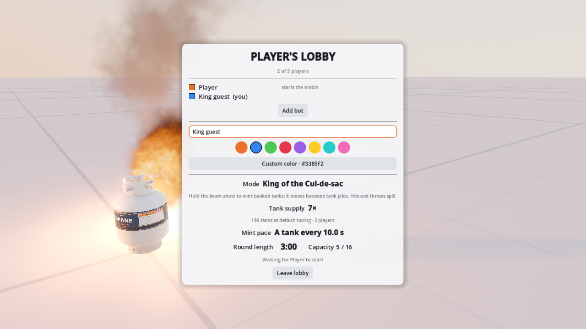
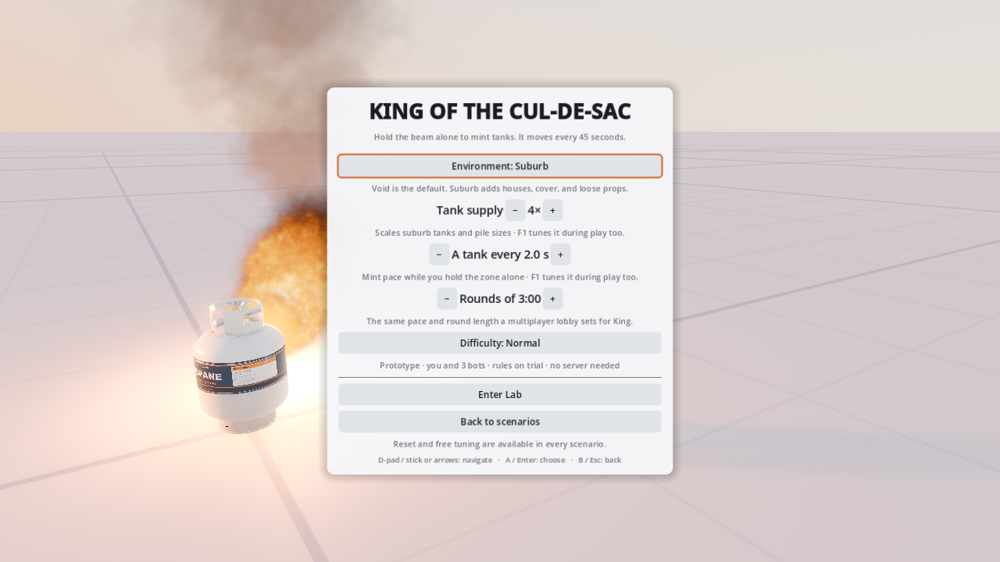

# Lobby and Lab tank supply verification

**Status:** Dated record (2026-10-14). Its "unreleased 0.4.0" shipped. The current rules are in
[multiplayer.md](../multiplayer.md#networking) (tank supply) and [lab.md](../lab.md) (the Lab setup pages).

The lobby and finite Lab suburb setups offer every integer from 1× to 8×. Integer steps match the existing
TankCountMultiplier tuner and make keyboard/controller adjustments predictable. A new lobby always starts at 1×.
The roster preview is labeled as a count at default tuning: guests do not know the creator's custom debug tuning
before start. Void fixtures and Dissolve Run's segment supply retain their existing counts and controls.

`4c6117e` adds the lobby wire, validates supply, applies it to generation and the shared snapshot, preserves the
creator's offline tuning, locks match F1 supply (including Defaults), and adds the native bot flag and seven unit
tests. `1669e70` adds the lobby/Lab controls, unsaved draft retention, real-device tests and player docs.
`c51c814` brings in `dev` through `c5591db`, including the faster full-gate harness. Verification is on that merged
code; the earlier full run interrupted for that update is discarded.

## Gates and device delivery

`make setup`, `make build`, and `make check` passed. All rebuilds were warning-free; the final check discovered
26 unit suites / 361 tests with zero failures. The seven supply tests cover every wire step in both modes, invalid
and truncated/trailing settings, phase/creator authority, a conflicting creator snapshot, lobby-bot roster supply,
match Defaults, and a late client actually assembling the same tank identities/poses after buffered Go. Original
mint validation now includes the new trailing supply field, so it still tests invalid mint values rather than
accidentally rejecting a truncated packet.

The final `make -j4 test-full` passed: all 361 unit tests, 700 navigation courses, 53 piles / 738 tanks through
120 simulated seconds, every deep generator shard and all Lab sessions. Coverage proved exactly 1,044 generator
seeds and 544 Lab cases (510 dial fixtures), each once. Both normal Debug and isolated optimized Debug rebuilds
had zero warnings/errors. The final native gate passed the faulted rifle soak, two blocked-duel matches and the
loading-readiness stall. Final rifle rest/moving was 0.000/0.225 m, longest episode 0.55 s, zero disagreements;
audits agree and all native logs are clean.

`python3 -B tools/dev/lint_tests.py` passed, including gate failure propagation and deep-shard coverage.
The following rendered commands passed with `TMPDIR="$PWD/build/lobby-tanks-tmp"`:

```sh
godot-mono --fixed-fps 60 --resolution 1280x720 res://scenes/dev/menu_test.tscn -- --scenario=input --port=24681 --capture-dir="$PWD/build/lobby-tanks-input"
godot-mono --fixed-fps 60 --resolution 1280x720 res://scenes/dev/menu_test.tscn -- --scenario=king --port=24681 --capture-dir="$PWD/build/lobby-tanks-menu"
```

Input passed 165 assertions with zero failures. The supply/King menu probe passed 114 assertions: mouse,
keyboard, stick/D-pad, bounds, stable focus, both lobby modes, guest presentation, Lab setups, generated supply
and draft retention. New control clicks use Input.ParseInputEvent through the root device path. Match F1 opens
and closes through real key events with supply omitted; offline F1 retains the tuner.

I reviewed `king_lobby_gamepad.png` and `king_lobby_guest.png`: the creator has −/value/+ and a default-roster
count; the guest sees the same 7× supply and 196-tank count without creator controls. I also reviewed
`lab_bank_supply.png`, `lab_king_supply.png` and `lab_shortfuse_supply.png`: each shows the 4× setup choice,
with King pace and difficulty still accessible. `match_03_jump.png` shows the airborne player in the real network
view. Captures stay under the directories above; the guest and King Lab views are retained here.

| Guest lobby | King Lab setup |
| --- | --- |
|  |  |

## Native multiplayer matrix

All five requested four-client, 90-second soaks used seed 23, --melee-start and a conflicting local
--tune.TankCountMultiplier=8. The server generated 36 tanks at 1× and 144 at 4× in both modes. Every case completed
with zero engine errors, zero tank disagreements and all four clients agreeing with the server's bank audit.
King's audit includes 19 minted tanks. These are separate headless native processes.

| Mode | Supply | Profile | Starting tanks | Final rest / moving (m) | Longest episode (s) | Result |
| --- | ---: | --- | ---: | --- | ---: | --- |
| Tank Bank | 1× | Clean | 36 | 0.000 / 0.000 | 0.10 | PASS |
| Tank Bank | 1× | Faults | 36 | 0.000 / 0.000 | 0.40 | PASS |
| Tank Bank | 4× | Clean | 144 | 0.003 / 0.078 | 0.90 | PASS |
| Tank Bank | 4× | Faults | 144 | 0.001 / 0.175 | 0.50 | PASS |
| King | 4× | Clean | 144 | 0.000 / 0.000 | 0.10 | PASS |

The 4× faulted case had a transient moving peak of 17.175 m despite passing the unchanged duration/final limits;
the final pair alone does not describe its entire trajectory. Checker limits were not relaxed.

Exact commands (with the same TMPDIR as the rendered runs):

```sh
for supply in 1 4; do
  tools/dev/net_bots.sh -n 4 -l 90 -t clean -s '--match-seed=23' -o "$PWD/build/lobby-tanks-net-clean$supply" -- --tank-supply="$supply" --tune.TankCountMultiplier=8 --melee-start
  tools/dev/net_bots.sh -n 4 -l 90 -t faults -s '--match-seed=23' -o "$PWD/build/lobby-tanks-net-fault$supply" -- --tank-supply="$supply" --tune.TankCountMultiplier=8 --melee-start --net-lag=120 --net-jitter=30 --net-loss=3
done
tools/dev/net_bots.sh -n 4 -l 90 -t clean -s '--match-seed=23' -o "$PWD/build/lobby-tanks-net-king4" -- --mode=king --tank-supply=4 --tune.TankCountMultiplier=8 --melee-start
tools/dev/net_bots.sh -n 2 -l 30 -t clean -s '--match-seed=23' -o "$PWD/build/lobby-tanks-net-lobby-bots" -- --tank-supply=4 --lobby-bots=1 --melee-start
```

The extra 30-second smoke has two native clients, each owning one lobby bot: four actors, 144 tanks, zero engine
errors/disagreements and matching audits. Final rest/moving was 0.001/0.063 m; longest episode 0.10 s.

## Remaining evidence and compatibility

One completed full-gate attempt failed its stock seed-25 / net-seed-2 faulted rifle soak: four resting-body pair
comparisons for tank 2010000d lasted up to 3.90 s, at a 0.152 m peak. Completion identities and audits agreed, and
engine logs were clean. An unchanged serial `make test-full-bots` rerun passed all three probes: the rifle soak
had zero disagreements, a 0.75 s longest episode and final rest/moving 0.000/0.200 m; both blocked-duel matches
and the loading-readiness stall also passed. This variability remains a convergence follow-up. No correction
code, gameplay rule or checker tolerance was changed to get a pass.

Windows/macOS and eightfold native capacity were not verified. The lobby preview deliberately uses default
tuning, and the setting only affects finite suburb supply/pile construction; it does not scale King's mint rate
or existing void/segment fixtures.

SetMode and LobbyState gain an int32 supply field, and the lobby choice now controls shared generation/tuning.
The existing multiplier tuner remains exported; no tuner is added or removed. Protocol.Version stays 3 as
requested for the unreleased 0.4.0 minor. Hello, Welcome and Rejected are unchanged. No branch was pushed.
