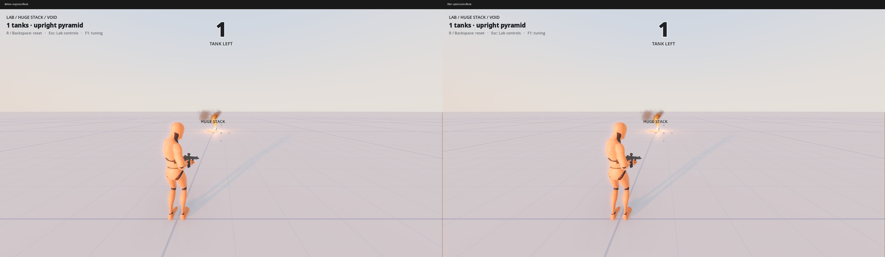
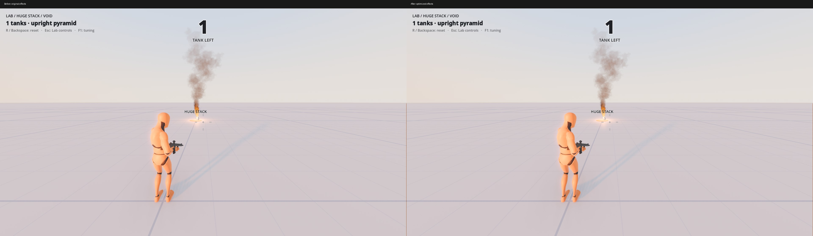
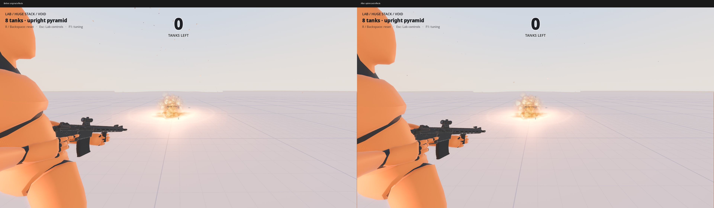
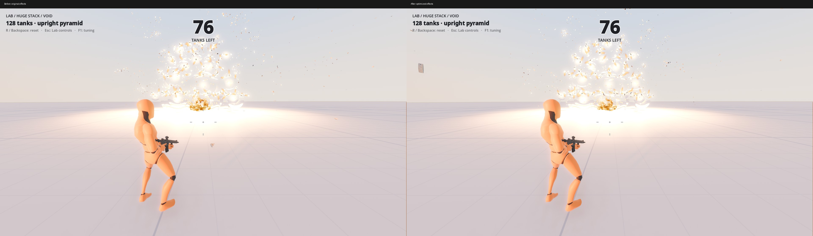
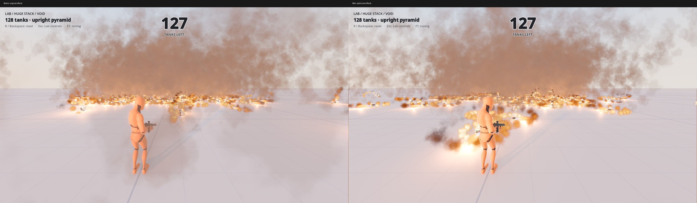

# Crowded effect profiling

**Status:** Dated record (2026-10-12). The measuring method is in [profiling effects](../runbooks/profiling-
effects.md), the vent light budget in [world-services.md](../world-services.md), and the stack range this report
discusses in [lab.md](../lab.md#stack-budget).

The Lab measurement uses 180 idle warm-up frames and 600 sampled real frames at 1920×1080, Forward+, seed 23,
and baked tuning. The trigger is included in the first wall sample. Opt-in `EffectProfile` timers are inclusive;
`Blast` includes the vents created by chain hits. These timers do not alter simulation decisions.

Before optimization, a 128-tank ordinary blast measured wall p50/p95/worst 116.3/152.1/236.1 ms and GPU p95
150.8 ms; physics p95 was 4.6 ms. Diagnostic exclusions identified lit smoke as the dominant persistent cost:
hiding smoke reduced GPU p95 to 18.4 ms; hiding all particles reduced it to 15.5 ms. Those first exclusion runs
traversed the tree every frame and are GPU evidence only, not valid CPU/GC measurements. The harness now applies
exclusions through NodeAdded instead. Omitting lights also saves substantial smoke lighting work. Vents already
have no shadows; explosions cap simultaneous shadow flashes at three.

Cold trigger timers measured about 86 ms vent construction, 46 ms explosion construction, 30 ms first scorch
texture construction and 8 ms debris construction. Blast's inclusive 68 ms includes newly punctured vents.
The primed 128-tank chain also showed a 1,330 ms wall spike, 140 ms debris construction in one frame and 565 ms
inclusive blast work. Lab sessions do not run the existing game/match effect warm-up. The repository has no audio
playback path, so these runs have zero audio voices. Jolt's active-body/contact Performance monitors return zero
here; that is unavailable telemetry, not evidence of zero contacts. Physics time remains measurable.

Diagnostics are not shipped presentation changes. Use `lab_test --scenario=measure --count=128 --phase=blast`
with `--metrics=<absolute path>` for raw CSV, or `--profile-hide=smoke|particles|lights|shadows|decals` for a
controlled rendering exclusion. Only newly created effect nodes are excluded; the sun is retained. GPU, wall,
render CPU, process, physics, object counts, compilation monitors, allocations and collection counts are printed.
`--scenario=effects --count=1|8|128 --capture-dir=<absolute path>` captures a single vent and primed chains.
Use `--fixed-fps 60` for those visual comparisons; omit it for throughput measurements.

## Implementation

Steady vent, explosion and debris heat updates reuse shader parameter names instead of allocating their C# wrappers.
The unit gate asserts these warmed update paths allocate zero managed bytes; presentation-only warm-up also leaves
the world's random stream unchanged.
The light manager writes each source and proxy's final visibility once, avoiding off/on renderer updates every frame.

Particle draw meshes and growth/shrink curves are shared immutable resources. Vent and explosion process
materials cache only the most recent scale; a tuning edit builds a new resource without mutating emitters already
in flight. CPU-generated scorch/hole/glow textures are built at session assembly. Lab starts the same effect
warm-up as the game, without adding physics bodies, and its hidden flash retires with its warm-up root. The
match's existing warm-up flash lifetime and shadow-slot accounting remain unchanged.

Smoke discards only exactly zero-opacity fragments, including completely depth-faded or lifetime-faded fragments,
before noise work and Forward+ lighting. Particle counts, lifetimes, colors, trajectories, smoke density, light
energy and every existing gameplay/effect dial stay unchanged.

Above `VentLightMergeThreshold` (40), at most `VentLightClusterCount` (8) proxy lights combine nearby vents at
energy-weighted centers. Seeds begin near the camera and then spread across the sources. A source farther than
`VentLightMergeRadius` (2 m) from every seed keeps its individual light: this is a soft budget, not permission
to relocate isolated vents' light across the world. Unmerged energy plus proxy energy equals the original total;
flash lights and their existing three-shadow limit are unaffected. At 40 vents or fewer, every original vent
light remains unchanged. The manager belongs to the world rather than a suburb; source retirement unregisters
lights automatically, source re-entry restores registration, and rebuilding content reuses the surviving service.
All three new presentation dials enter match tuning snapshots (minor-release scope);
no network message changes and no `Protocol.Version` change.

Blast query paging preserves engine hit order, duplicate shapes and caller exclusions. It uses a managed RID
hash set on full pages instead of repeated native linear searches, and skips exclusion work on the final short
page because no more query is needed. Queries still visit every body and apply the same impulses and chain rules.
One ray-query resource belongs to each detonation: its origin and mask remain fixed while synchronous sight
checks update only the target. Nested detonations receive their own resource.
The dense-query harness asserts 1,100 bodies across multiple pages, caller exclusions, short-page hit order and
occluded/clear receivers on opposite sides of a wall across successive detonations.

Recreate the measured baseline from common dev revision `729c8c8`; the overlay adds timers to original effect paths
and copies the current dev harness, without any optimized effect, tuning or warm-up code:

```sh
python3 -B tools/dev/prepare_vent_baseline.py --ref=729c8c8 --output="$PWD/build/pv-before"
python3 -B tools/dev/measure_vents.py --baseline=build/pv-before --output="$PWD/build/pv-measurements"
```

`tools/dev/measure_vents.py --baseline=<scratch project> --output=<absolute directory>` alternates two builds
back to back, twice at 32/64/128/40 tanks in idle/blast/chain phases. It preserves 600 raw samples per run, logs,
before/after machine load and a summary CSV; missing GPU samples, engine errors or a failed scene abort it.
Rendered harnesses also accept `--frame-metrics=<directory>` for per-process CSV telemetry after 180 startup
frames, monotonic timestamps and explosion counts for locating the largest rendered burst. GPU readings are delayed
relative to script timers, and Performance phase monitors can repeat across samples. Use direct timers for
individual CPU spikes, not repeated monitor values.

## Final repeated comparison

October 12, 2026, GTX 1660, Godot 4.7.2 .NET, Forward+, 1920×1080, baked tuning and seed 23.
The baseline is common dev `729c8c8` plus diagnostics; optimized effects are through `a8b17c1`.
Each case alternates before/after twice: 180 idle warm-up frames followed by 600 sampled frames per run.
Each triple below is pooled **p50 / p95 / worst**, in milliseconds, across 1,200 samples.
[Every repeat and system](perf-vents/measurements.csv) and [load snapshots summarized numerically](perf-vents/load.csv)
are retained. Full raw frames, engine logs and `nvidia-smi`/`uptime` snapshots are in `build/pv-final/` locally.

One-minute CPU load ranged from 5.89 to 38.00; snapshots showed 0–3 other rendered Godot processes.
These are shared-load results, not isolated hardware limits. Even idle runs had scheduling spikes. GPU reductions
are clearer than wall results; the 128-tank chain wall result regressed in the pooled comparison. The backend also
reported a 60 Hz VSync fallback despite `--disable-vsync`. Do not infer a stable frame budget from a median.

| Tanks | Phase | Wall before | Wall after | GPU before | GPU after |
| ---: | --- | ---: | ---: | ---: | ---: |
| 32 | idle | 16.7/20.2/82.7 | 16.6/20.7/54.2 | 6.5/9.6/14.6 | 6.5/10.1/15.1 |
| 32 | blast | 18.7/29.7/430.8 | 17.4/25.7/167.5 | 17.7/26.4/32.6 | 16.1/22.2/32.3 |
| 32 | chain | 29.1/86.8/607.6 | 21.0/78.7/343.0 | 7.2/13.4/39.2 | 7.3/12.9/37.5 |
| 40 | idle | 16.7/17.1/36.5 | 16.6/19.8/56.9 | 6.6/9.4/15.4 | 6.6/10.7/14.8 |
| 40 | blast | 27.0/43.0/422.2 | 27.4/38.5/141.0 | 26.3/37.5/60.1 | 26.1/37.5/44.2 |
| 40 | chain | 20.4/107.4/867.8 | 21.9/99.1/567.7 | 6.5/16.6/34.2 | 6.8/16.4/49.0 |
| 64 | idle | 16.7/19.5/46.4 | 16.7/18.2/37.2 | 6.7/10.7/16.4 | 6.7/11.0/16.4 |
| 64 | blast | 40.4/67.0/239.6 | 42.4/61.5/129.9 | 39.2/62.6/96.7 | 40.6/58.6/75.6 |
| 64 | chain | 17.2/129.4/1184.7 | 16.9/40.0/443.3 | 6.3/15.9/65.0 | 5.2/9.6/24.6 |
| 128 | idle | 16.7/19.3/54.3 | 17.0/30.8/206.7 | 6.8/7.5/13.8 | 6.9/10.8/15.3 |
| 128 | blast | 156.9/199.2/1334.4 | 109.8/219.0/356.2 | 154.3/193.1/258.2 | 102.9/138.5/193.6 |
| 128 | chain | 71.7/292.6/3108.4 | 69.2/484.5/3907.6 | 9.1/37.7/161.8 | 10.0/45.2/235.3 |

The 128-tank targets are **not met**, and no larger shipped maximum is justified. Keep the adjustable product
range at 24–40. The best tested ordinary-blast GPU p95 is 22.2 ms at 32 tanks under this load; 40 tanks measured
37.5 ms, and 128 measured 138.5 ms. Primed chains still have large CPU/physics spikes. No claim of uninterrupted
60 FPS or hitch-free suburb play follows from these changes.

## Final profiler breakdown

Direct scopes below report p95 / worst milliseconds per sampled rendered frame at 128 tanks, pooled over both
repeats. Construction and blast work occupies fewer than 5% of frames, so its p95 is often zero: the worst column
is the useful burst measurement. Scopes are inclusive and contain native calls, waits, GC and scheduling as well
as C# work; they cannot be added together. Native physics phase monitors include scripts and can repeat across
render frames without a physics tick; GPU readings are delayed.

| System | Ordinary before | Ordinary after | Primed before | Primed after |
| --- | ---: | ---: | ---: | ---: |
| GPU | 193.1 / 258.2 | 138.5 / 193.6 | 37.7 / 161.8 | 45.2 / 235.3 |
| Latest native physics phase | 17.3 / 98.4 | 29.3 / 131.0 | 31.6 / 395.8 | 64.7 / 597.9 |
| Tank physics callbacks | 6.560 / 13.844 | 10.236 / 26.251 | 0 / 3.059 | 0 / 7.331 |
| Vent construction | 0 / 494.016 | 0 / 26.981 | 0 / 154.053 | 0 / 28.876 |
| Vent update | 1.724 / 63.107 | 1.184 / 10.328 | 0 / 2.494 | 0 / 2.148 |
| Vent light manager | 0 / 0 | 7.634 / 14.624 | 0 / 0 | 0.006 / 14.177 |
| Explosion construction | 0 / 255.163 | 0 / 0.652 | 0 / 99.591 | 0 / 92.755 |
| Explosion update | 0.041 / 0.684 | 0.025 / 1.380 | 1.923 / 34.760 | 1.019 / 135.776 |
| Blast, inclusive | 0 / 137.366 | 0 / 69.030 | 0 / 1199.252 | 0 / 1111.486 |
| Native shape queries | 0 / 0.981 | 0 / 1.063 | 0 / 130.919 | 0 / 223.443 |
| Query exclusions | 0 / 2.586 | 0 / 0 | 0 / 201.307 | 0 / 50.827 |
| Body pushing, including rays | 0 / 121.479 | 0 / 59.046 | 0 / 619.553 | 0 / 414.546 |
| Blast receivers | 0 / 2.348 | 0 / 1.724 | 0 / 4.213 | 0 / 3.923 |
| Debris creation and placement | 0 / 43.003 | 0 / 11.487 | 0 / 280.625 | 0 / 437.268 |
| Debris heat update | 0.053 / 1.262 | 0.013 / 0.036 | 3.750 / 56.396 | 1.412 / 7.705 |
| Scorch construction | 0 / 80.221 | 0 / 0.390 | 0 / 51.613 | 0 / 10.463 |

Steady vent, explosion and cooling-debris update scopes record zero managed allocation after optimization.
The unit gate independently asserts this after one warm call. Primed-chain total GC pause across a run reached
594.7 ms before and 607.2 ms after in this noisy pair; allocation reductions do not prove a GC-latency guarantee.
Ordinary-blast surface-pipeline counts fell from 12 to 5; specialization counts remained 29. Warm-up primes CPU
resources but does not warm every first-visible draw variant. Audio voices remain zero. Jolt contact counts are
unavailable here, so contact-exclusive timings and a clean native Jolt breakdown remain unverified.

A controlled after-build light exclusion measured GPU p95 38.8 ms at 128 ordinary-blast tanks, with the sun
retained. Combined with the original smoke exclusion (18.1 ms), this identifies substantial remaining smoke
fragment and lighting cost. Disabling shadows or decals in the original diagnostic runs did not explain that
persistent cost. Redundant source/proxy visibility toggles introduced by the first manager implementation were
caught by its timer and removed; the complete intermediate matrix remains in `build/pv-before-visibility-fix/`.

## Rendered suburb matches

Four smart bots played 90-second seed-23 matches, one rendered at 1080p with VSync disabled, three headless.
No screenshot readback or recording ran during timing. Both builds passed tank agreement (zero disagreements)
and all four bots agreed with the server bank/score audit. Autonomous matches take different action sequences:
55 explosions before and 69 after. This is observed play, not a controlled identical-action replay.

[Match statistics](perf-vents/matches.json) use monotonic frame timestamps aligned with play-phase tank-check
samples. The largest one-second rendered explosion burst contained 12 explosions in each match. Its timing
window includes 0.25 seconds on either side to cover delayed GPU readings and nearby physics work.

| Window | Wall before p50 / p95 / worst | Wall after | GPU before | GPU after |
| --- | ---: | ---: | ---: | ---: |
| Entire play phase | 16.9 / 38.2 / 356.5 | 16.9 / 62.0 / 288.2 | 10.4 / 16.3 / 24.0 | 10.8 / 16.8 / 60.9 |
| Largest 12-explosion burst | 23.8 / 49.9 / 58.7 | 18.0 / 57.4 / 84.3 | 14.0 / 18.2 / 19.9 | 14.4 / 19.1 / 22.2 |

These runs do not establish a hitch-free suburb match. An earlier timestamped baseline attempt lost one peer
before play and failed coverage/final-score checks; it was excluded and preserved in `build/pv-net-disconnect-before/`.
The successful retry used port 24982. Successful logs, raw frame CSVs and load snapshots are in
`build/pv-net-final-before/` and `build/pv-net-final-after/`. A previous pair without timestamps also passed both audits.

To repeat, use `tools/dev/net_bots.sh -n 4 -l 90 -w 1 -t clean -p 24982 -s '--match-seed=23'`
with `-o "$PWD/build/pv-net" -- --frame-metrics="$PWD/build/pv-net" --bot-log --digest-every=1 --melee-start`.
For 1080p timing supply `-g "$PWD/build/pv-godot"`, a wrapper that replaces the tool's 960×540 resolution with
1920×1080, adds `--disable-vsync`, and invokes `godot-mono` by name. For the baseline, replace the wrapper's
`--path` argument with the prepared scratch project's path. Run the builds serially and record load around each.

## Visual review

Fixed-FPS 1080p `lab_test --scenario=effects --count=1|8|128` runs completed successfully for both builds.
Particles use fixed seeds for this review. Left is original, right is optimized. I reviewed all five comparisons:
the single vent and mature smoke retain their appearance; the small pile retains flame, flash and smoke density;
the huge early chain retains the layered burst. The extreme persistent field shows the radius-limited lighting
approximation. Later tank/debris positions differ between independent runs, so that field is not a pixel-identity
or isolated photometric test. All original captures remain in `build/pv-frames-before-*` / `build/pv-frames-after-*`.







Further investigations are a smoke rendering path with less fragment/lighting work, and finer native
body-registration, query and Jolt profiling. No particle reduction, contact/CCD change, body pooling, gameplay
retuning or replication change was used to improve these measurements. Windows/macOS throughput and isolated
GPU/CPU performance were not verified.


## Verification record

The final code includes common dev revision `729c8c8`, merged before verification, followed by `make setup`.
`make build` and `make check` passed with zero compiler warnings. Check includes `make test`, the 241-test
unit suite, dense blast queries, real device-input delivery (161 assertions, zero failures), bounded forced
formations and four separate-process world hashes matching the unchanged reference.
`TMPDIR="$PWD/build/pv-gates" make check` and `TMPDIR="$PWD/build/pv-gates" make test-full` both exited zero;
logs are `build/pv-gates/check-final.log` and `build/pv-gates/full-final.log`.
The full gate passed its faulted four-bot soak with zero tank disagreements, full Lab lifecycle/rules/duels,
deep awake upright checks (maximum drift 1.669 mm, tilt 0.151 degrees), menu lifetime, player/recoil probes,
200 base seeds, six seeds per forced formation/size, 200 two-player and 100 each eight-/sixteen-/twenty-four-/
thirty-two-player suburb cases. Navigation passed all 700 courses across 100 seeds, with zero stuck events.

Measurement proof used these commands, with `TMPDIR` inside this checkout's `build/`:

```sh
python3 -B tools/dev/prepare_vent_baseline.py --ref=729c8c8 --output="$PWD/build/pv-final-baseline"
python3 -B tools/dev/measure_vents.py --baseline=build/pv-final-baseline --output="$PWD/build/pv-final" --counts=128,32,64,40 --repeats=2
godot-mono --headless --fixed-fps 60 --path . res://scenes/dev/unit_tests.tscn
godot-mono --headless --fixed-fps 60 --path . res://scenes/dev/blast_query_tests.tscn
```

The baseline setup, both focused suites and all 48 timing runs passed. Initial profiling additionally ran
`lab_test --scenario=measure --count=128 --phase=blast|chain` with the smoke, particles, lights, shadows and
decals diagnostic exclusions described above. Each timing run recorded `nvidia-smi` and `uptime` before and
after. The final rendered match command is documented in the match section; both successful final matches
passed agreement and score audits. One failed baseline attempt remains explicitly excluded above.

Visual proof ran both projects with
`godot-mono --fixed-fps 60 --resolution 1920x1080 res://scenes/dev/lab_test.tscn -- --scenario=effects --count=N --windowed --capture-dir="$PWD/build/pv-frames-LABEL-N"`
for N=1, 8 and 128. All six scenes passed, and all five retained side-by-side images were inspected.
Large scratch baseline copies were removed after measurements; the baseline preparer can recreate them.
Raw timing, capture, match and gate logs remain under `build/pv-*`; numeric summaries and reviewed images are
retained with this report. No recordings were made.
