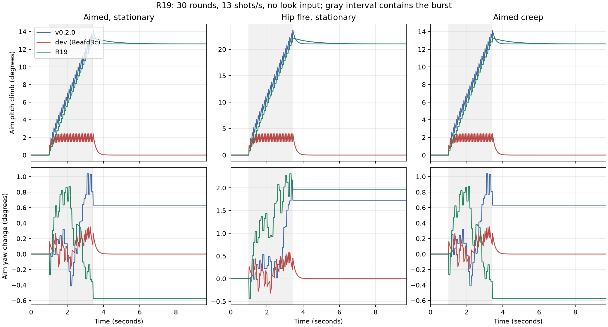

# Recoil (R19)

The owner asked for the climb of `v0.2.0` to require player correction again, and for shots to follow the visible
barrel. R19 moves shot recoil into logical aim, retains most of it, and aligns the rifle to each sampled shot.
The weapon and camera springs supply short presentation kick independently of the primary aim ray. Damage,
spread sampling, bloom, fire rate, ammunition and tank/blast rules are unchanged.

## Climb

The release did have automatic recovery: at 7/s it returned 65% of a pitch kick and transferred the remaining 35%
into input pitch. Its random sideways kick remained in input yaw. Dev at `8eafd3c` returned both recoil offsets
completely. The rifle's separate `RecoilSpring` also returned to zero; it could not preserve aim climb.

R19 applies the kick directly to logical pitch, with a bounded budget for only the automatically settling share.
Mouse, stick and bot look displacements change that same orientation. Pitch limits apply before adding the budget,
so blocked kick cannot wind up a later downward pull. Spawn orientation resets the budget.

| Tuner | C# default | Baked game | Meaning |
| --- | ---: | ---: | --- |
| `RecoilKickDegrees` | 0.28 | 0.8 | Immediate logical pitch per hip shot |
| `RecoilReturnShare` | 0.125 | 0.125 | Share allowed to settle automatically |
| `RecoilSettleSpeed` | 1 | 1 | Exponential settle rate, per second |
| `RecoilYawDegrees` | 0.175 | 0.5 | Uniform persistent sideways range, either direction |
| `CameraRecoilKickDegrees` | 0.35 | 0.35 | Separate camera spring impulse |
| `RifleShotPoseAngularSpeed` | 2400 | 2400 | Body/head response on a shot, degrees/s |
| `BotRecoilControlSpeed` | 2.8 | 2.8 | Local brain correction rate, per second |

`AimRecoilScale` stays 0.6. The new retained hip increment is `0.8 * 0.875 = 0.7` degrees, matching the release's
`2 * 0.35`; the C# defaults match by the same factor. There is less automatic motion and a slower, smaller return.
The existing rifle spring frequency, damping, impulse, compression and lift tuners also govern the visible kick.
The camera spring uses that frequency/damping and adds only a local camera rotation. Rifle placement still supplies
the muzzle obstruction ray, as before; presentation never rotates the primary logical ray.

Local Lab bot soaks also exercise abrupt turns while firing. Shot fitting now synchronizes the visual body to
the facing already resolved by movement, so physics fits the muzzle in the same frame that rendering uses.
It also clears a finished reload's presentation contact before fitting the firing foregrip: physics may fire
before rendering has advanced the last magazine/bolt pose.
When a new animation sample moves the hips, the cached upper root is rebased into that sample's parent frame
before constraining the firing torso. The fitting skeleton's world frame is retained too, covering a second
movement tick before rendering. The fixed shot muzzle can then keep both contacts as the body and clip advance.
Upper-body constraint trials reject out-of-reach wrists before solving IK; the final trial retains contact
error reporting. This fixes transient turn/contact errors without changing recoil, spread or the primary ray.

Remote reliable shot echoes are queued until the rig samples the displayed body frame. Receipt can precede
snapshot relocation/facing and can still see a reload contact that presentation will overwrite. Fitting and
emitting the flash/tracer together inside the modifier keeps the firing muzzle, cached upper root and foregrip
in one frame. A delayed echo also owns the firing frame's weapon presentation if the displayed snapshot has
already entered melee; the character restores that action on the next frame. Firing also clears the old
reload-return direction, so restoring melee cannot restart an obsolete magazine contact. Local shots keep their
immediate authoritative fit and obstruction query; received echo endpoints and logical recoil are unchanged.
Multiple echoes in a catch-up frame each emit their effects; the last pose renders.

A second failure occurred at close endpoints: alternating barrel alignment about the muzzle with restoring a
contact pivot can oscillate across the endpoint. The final exact barrel correction then puts the wrists outside
reach, even in the fitting frame. When that correction would violate reach, an analytic fallback intersects the
two arms' reach intervals along a positive barrel ray ending at the original endpoint. It translates the rifle
within that intersection, keeping both contacts and exact alignment. The ordinary pivot/cheek fit is unchanged;
in the fallback, grip reach takes priority over a cheek hold that the current body frame cannot supply. No endpoint
is moved and no shot waits for a pose transition. The authored animation rig carries near eased aim and seeks
the firing clearance reserve before the trigger press, reducing the first hip-shot arm snap.

`rifle_reach_tests` applies echo/snapshot orderings explicitly, across eight body facings, relocation, displayed
reload, melee, reload completion, 80 close endpoints in hip/aimed holds at match-sized coordinates and get-up handoff. It checks final wrists (3 mm), barrel/endpoint angle (0.05 degrees), emitted tracer
origin (0.1 mm) and delivery of every echo. `make check` runs this fast deterministic scene; `make test-full` also
runs a faulted four-bot 90-second match. The network launcher fails any run with logged engine or protocol errors,
including rifle reach/contact errors, even when tanks and scores agree. The reach hotfix itself changes no shared tuners or messages, and `Protocol.Version` stays 2.
The authored animation redo changes the presentation tuner schema and therefore requires a minor release.

### Animation redo accuracy review

The animation branch's independent comparison with the reach hotfix (`729c8c8`) preserves the nine owner
magazines' climb and retention. All barrel/tracer checks remain within 0.05 degrees. It does **not**
preserve deterministic bot hit counts: at 8/20 m, easy bots change from 164/100 to 166/115 hits, hard bots from
188/182 to 197/184, and simple bots from 193/194 to 204/194, each out of 300 shots.

An instrumented 60-shot comparison finds identical primary ray inputs and random state. On shot 55 both
primary rays miss, but the new carry's different muzzle origin makes its secondary obstruction ray hit the
target. Rifle placement therefore affects gameplay outcomes even when logical aim, spread, timing and the hit
query rules are unchanged. Matching the old counts is an unresolved acceptance requirement; changing or
decoupling that obstruction path requires a gameplay decision before the animation redo can land.

### Measured curves

Each series is a real full-auto 30-round magazine, no look input, initial pitch -10 degrees, fixed 60 Hz rendering
and 120 Hz physics. All use their own baked tuning, including 13 shots/s, and seed 19019. `creep` holds effective
aim while moving. Yaw is measured from the actual logical ray (the camera ray in the historical fixtures), rather
than the old public input-yaw accessor. Values are changes from the initial orientation, in degrees. “After” is
five seconds after the last shot, and “return” is peak pitch minus that remaining climb. Yaw peak is signed, chosen
by maximum absolute displacement. Random streams can diverge when hit/effect histories differ between versions.

| Version | Stance | Peak pitch | Pitch after | Return | Yaw peak | Yaw after | Max shot/barrel angle |
| --- | --- | ---: | ---: | ---: | ---: | ---: | ---: |
| v0.2.0 | aim | 14.171 | 12.600 | 1.571 | 1.037 | 0.632 | 1.698 |
| v0.2.0 | hip | 23.618 | 21.000 | 2.618 | 2.171 | 1.728 | 22.335 |
| v0.2.0 | creep | 14.171 | 12.600 | 1.571 | 1.037 | 0.632 | 1.994 |
| dev (8eafd3c) | aim | 2.416 | 0.000 | 2.416 | 0.352 | 0.000 | 3.813 |
| dev (8eafd3c) | hip | 4.027 | 0.000 | 4.027 | 0.586 | 0.000 | 19.816 |
| dev (8eafd3c) | creep | 2.416 | 0.000 | 2.416 | 0.352 | 0.000 | 3.940 |
| R19 | aim | 13.277 | 12.605 | 0.673 | 0.873 | -0.576 | 0.033 |
| R19 | hip | 22.129 | 21.008 | 1.121 | 2.311 | 1.957 | 0.032 |
| R19 | creep | 13.277 | 12.605 | 0.673 | 0.873 | -0.576 | 0.042 |



[Raw curves](recoil/curves.csv) include per-shot and final-pose angle samples. Historical fixtures are isolated
`git archive` copies under this checkout's `build/`; only the measurement harness is instrumented. No branch switch
or player-code substitution is needed. The historical bot fixture exposes the old aim helpers without replacing
their algorithms. `plot_recoil.py` requires matplotlib only for this optional report, never for `make test`.

## Barrel alignment

The primary ray retains its existing chest-plane projection, random cone sampler and hit query. Before the muzzle
obstruction query, the rig solves a reachable rifle placement toward that endpoint. After any obstruction, the
barrel rotates about the same muzzle to face the actual endpoint. The tracer, flash and shot report now agree with
that barrel. No endpoint is moved to manufacture alignment. Remote Shot presentation uses the received endpoint
and the same placement solve; attacker authority and messages are unchanged.

The firing frame retains the sampled pose; intervening burst frames follow logical aim, including the first
hip-ready transition. The solver alternates barrel alignment with arm/aimed-eye reach projection. Both wrist
contacts and the cheek hold remain solved. Carry, reload and melee retain their existing presentation paths.
The firing placement is held exactly; if it approaches an arm's reach, the surrounding body eases instead of
moving the muzzle a second time. The rendered muzzle has a separate **0.1 mm** origin-error bound. All seven
magazines measure 0.000000 m maximum error at the CSV's micrometer precision.

The asserted bound is **0.1 degree**, for both the firing model and the final skinned firing frame. Intervening
tracking frames also assert that bound against the current logical target. Seven magazines cover 210 shot frames
and more than 800 intervening frames, including close floor endpoints, upward aim and the pitch ceiling:

| Stance | Initial pitch | Shot and rendered maximum | Intervening maximum |
| --- | ---: | ---: | ---: |
| aim | -10 | 0.032914 | 0.042136 |
| hip | -10 | 0.031568 | 0.044504 |
| creep | -10 | 0.042361 | 0.042006 |
| aim | -60 | 0.043364 | 0.037633 |
| hip | -60 | 0.040025 | 0.041786 |
| aim | 30 | 0.001523 | 0.011786 |
| hip | 30 | 0.003586 | 0.042785 |

Hip fire starting at 30 degrees reaches the existing 45-degree limit; its remaining climb is 14.510 degrees,
with only accepted kick contributing to automatic settle. All seven runs pass grip and motion assertions.
The extended full-pitch grip sweep also passes, including near-floor cheek reach.
An additional hip magazine begins on spawn (`--burst-start=0`); all 30 shot/rendered frames pass, with maximum
shot angle 0.031723 degrees and intervening angle 0.044466 degrees.
An airborne magazine jumps before firing, fires 11 shots in the air and crosses the landing/aim transition. It passes
the same grip, motion and origin bounds, with shot/rendered angle 0.034111 degrees and intervening angle 0.041994 degrees.

Instant barrel correction requires instant arm contact frames. The motion probe measures those separately while
retaining the existing bounds for other bones and nonfiring arms. Ordinary aimed bursts reach about 3.5 degrees
of arm change per frame; the first hip raise reaches 41 degrees at the standard pitch, and 92 degrees when starting
at 30 degrees upward. Abrupt camera jumps in the artificial full-pitch sweep reach 177 degrees. These are visible
animation tradeoffs for the following character animation work, not
claims that the old 25-degree firing-arm bound still passes. Body/head firing motion uses the explicit 2400/s tuner.

## Bot comparison

Both brains now retain a desired target view and apply look displacement against observed climb. Target-turn
smoothing and skill wobble are preserved. Correction is gradual at `BotRecoilControlSpeed`, rather than resetting
logical aim every tick. This tuner is local to bot brains, following the existing unexported bot dials.

The paired range uses the production aim controllers and the actual player capsule. Each trial fires ten full-auto
magazines (300 shots), seed 19019, stationary shooter/target, with the smart brain's settled tracking wobble and
skill smoothing. At 8 m shots are hip-fired; at 20 m they are aimed. This isolates recoil correction from navigation,
reaction delay and burst gating. All 3,600 before/after shots are covered.

| Brain | Distance | Dev hits / 300 | R19 hits / 300 | Hit-rate change |
| --- | ---: | ---: | ---: | ---: |
| Smart, easy (0) | 8 m | 162 (54.0%) | 164 (54.7%) | +0.7 points |
| Smart, easy (0) | 20 m | 102 (34.0%) | 100 (33.3%) | -0.7 points |
| Smart, hard (1) | 8 m | 180 (60.0%) | 188 (62.7%) | +2.7 points |
| Smart, hard (1) | 20 m | 174 (58.0%) | 182 (60.7%) | +2.7 points |
| Simple | 8 m | 186 (62.0%) | 193 (64.3%) | +2.3 points |
| Simple | 20 m | 194 (64.7%) | 194 (64.7%) | 0.0 points |

This small deterministic fixture supports similar accuracy; it does not prove identical difficulty in every match.
The melee and duel network scenarios additionally pass with 120 ms lag, 30 ms jitter and 3% loss, with both clients
agreeing with the server's score audits. Duel still demonstrates hit grace, drops, tank detonation and blast throw.

## Reproduce and review

Run from the worktree, with `TMPDIR` under `build/`. The baseline destination must be fresh.

```sh
mkdir -p build/rcl-scratch
export TMPDIR="$PWD/build/rcl-scratch"
make build
make check
python3 -B tools/dev/recoil_baselines.py --output build/rcl-reproduced
for stance in aim hip creep; do
  godot-mono --headless --fixed-fps 60 res://scenes/dev/player_range.tscn -- --scenario=recoil --stance=$stance --assert-grip --assert-motion --capture-dir="$PWD/build/rcl-branch-$stance"
done
python3 -B tools/dev/plot_recoil.py --baselines build/rcl-reproduced --branch build --output docs/recoil
for stance in aim hip; do
  for pitch in -60 30; do
    godot-mono --headless --fixed-fps 60 res://scenes/dev/player_range.tscn -- --scenario=recoil --stance=$stance --pitch=$pitch --assert-grip --assert-motion --capture-dir="$PWD/build/rcl-$stance-$pitch"
  done
done
godot-mono --headless --fixed-fps 60 res://scenes/dev/player_range.tscn -- --scenario=recoil --stance=air --assert-grip --assert-motion --capture-dir="$PWD/build/rcl-air"
for skill in 0 1; do
  for distance in 8 20; do
    godot-mono --headless --fixed-fps 60 res://scenes/dev/player_range.tscn -- --scenario=bot-recoil --skill=$skill --distance=$distance
  done
done
for distance in 8 20; do
  godot-mono --headless --fixed-fps 60 res://scenes/dev/player_range.tscn -- --scenario=bot-recoil --brain=simple --distance=$distance
done
mkdir -p build/rcl-player-final build/rcl-side-final
godot-mono --fixed-fps 60 --disable-vsync --resolution 1280x720 res://scenes/dev/player_range.tscn -- --scenario=recoil --stance=aim --view=player --assert-grip --assert-motion --capture-dir="$PWD/build/rcl-player-final" --record="$PWD/build/rcl-player-final/burst.mp4"
godot-mono --fixed-fps 60 --disable-vsync --resolution 1280x720 res://scenes/dev/player_range.tscn -- --scenario=recoil --stance=hip --view=side --assert-grip --assert-motion --capture-dir="$PWD/build/rcl-side-final" --record="$PWD/build/rcl-side-final/burst.mp4"
godot-mono --fixed-fps 60 --disable-vsync --resolution 1280x720 res://scenes/dev/menu_test.tscn -- --scenario=input --port=24693 --capture-dir="$PWD/build/rcl-input-rendered"
tools/dev/net_bots.sh -o "$PWD/build/rcl-net-melee-final" -n 2 -w 0 -l 25 -s '--start-score=5' -- --scenario=melee --assert-grip --assert-motion --net-lag=120 --net-jitter=30 --net-loss=3
tools/dev/net_bots.sh -o "$PWD/build/rcl-net-duel-final" -n 2 -w 0 -l 25 -s '--start-score=8' -- --scenario=duel --net-lag=120 --net-jitter=30 --net-loss=3
for scenario in melee duel; do
  python3 -B tools/dev/check_scores.py build/rcl-net-$scenario-final/server.log build/rcl-net-$scenario-final/bot1.log build/rcl-net-$scenario-final/bot2.log
  python3 -B tools/dev/compare_tanks.py build/rcl-net-$scenario-final/bot1.log build/rcl-net-$scenario-final/bot2.log
done
```

Rendered proof is retained in ignored `build/rcl-player-final/` and `build/rcl-side-final/`: `burst.mp4` plus
`burst_01`, `burst_10`, `burst_20` and `burst_30` PNGs. The clips encode 30 frames/s. Shot screenshots and decoded
burst sequences show the tracer extending from the barrel, retained climb and stock compression with both grips
attached. The player view's horizon moves with the climb; the side view shows the barrel progressively rising.
The real device-input scene injects `Input.ParseInputEvent`, holding the mouse trigger and delivering corrective
mouse motion in both single-player and network views. It passes 72 assertions, including persistent climb after
release and successful pull-down. Its `single_burst_climb` and `match_burst_climb` captures show the raised aim.

`make check` includes the headless device test, four recoil magazines, a two-magazine bot smoke check, all existing
behavior/core suites, bounded generator/formation sweeps and separate-process hashes. Unit tests distinguish logical
climb from camera spring motion, check 30/60/120 Hz settle and exercise close/vertical muzzle-preserving alignment.
Deep bot comparisons stay outside the fast gate; `make test-full` includes a ten-magazine range run and the airborne
magazine.

No Windows/macOS run, human feel judgment or frame-time claim is made here. Older custom recoil presets need
retuning: a release kick multiplied by 0.4 preserves its retained pitch increment with the new defaults. No saved
preset migration is attempted. This changes shared tuners and requires a **minor release**. `Protocol.Version`
remains **2**; no message changes shape, suburb construction and tank rules are unchanged.

## Rifle reach hotfix verification

Verified on Linux against `dev` at `5a82ac9`. The baseline checked four-bot soak failed with 1,117 unreachable
wrists and 13 contact errors even though tanks and scores passed. Deterministic failures isolated snapshot
relocation (0.935 m wrist residual), the close-endpoint pivot oscillation (0.674 m), reload/melee presentation
replacing a firing pose (10.66/105.83 degrees from the tracer), and a stale late-reload return restarting after
the echo (0.204 m off the foregrip).

The final regression measures 2,152 final-pose samples and 118 firing frames, including all 126 delivered echoes.
Maximum wrist residual is **0.000263 m**, barrel/endpoint angle **0.039653 degrees**, and emitted/final muzzle
origin difference **0.000000 m**. It also requires melee to resume immediately with its foregrip contact intact.

All following checked matches used seed 25, network seed 2, close-pair melee starts and 90-second play. Faults
were 120 ms lag, 30 ms jitter and 3% loss; the eight-player server used the existing debug admission override.

| Players | Profile | Runs | Rifle/engine/protocol errors | Tanks and scores |
| --- | --- | ---: | ---: | --- |
| 4 | Faults | 3 | 0 | Pass |
| 4 | Clean | 2 | 0 | Pass |
| 8 | Faults | 1 | 0 | Pass |
| 4 | Faults, `make test-full` gate | 1 | 0 | Pass |

Nine owner magazines (aim/hip/creep, up/down, spawn and air) and eight 300-shot bot runs have identical before/after
summaries. Aim/creep peak/retained pitch remains 13.277431/12.601143 degrees; hip remains 22.129059/21.001911.
Across the nine magazines, shot/rendered angle peaks at 0.043364 degrees, intervening tracking at 0.044504 degrees,
and tracer-origin error stays zero. Smart easy hits remain 164/100 at 8/20 m, smart hard 188/182, and simple
193/194 (both skill arguments). The primary ray, recoil climb, spread and immediate owner firing are unchanged.

`make build` is warning-free; `make check` and `make test-full` pass, including real device input and 700/700 deep
navigation courses with no stuck runs. The reported single-player seed-23/effects-seed-4 clear scenario also passes
without rifle errors under concurrent test load. A probe that launched during a rebuild could not load C#; its
run was discarded, and all final recoil probes were rerun after builds completed with a startup timeout.

Ignored proof remains in `build/rr-proof-{fault-1,fault-2,fault-3,clean-1,clean-2,fault-8}/`,
`build/rr-proof-{check,full}.log`, `build/rr-before/`, `build/rr-after/` and `build/rr-recoil-comparison.txt`.
Rendered `movement` and `melee` fixtures, from another player's actual camera, pass grip/motion and network checks.
Their reviewed frames are in `build/rr-proof-movement-shots/` (`remote_08_hip_fire`, `remote_09_aim_fire`,
`remote_10_reload`) and `build/rr-proof-melee-shots/` (`remote_getup`, `remote_getup_handoff`). Camera distance 1 m
and FOV 30 degrees are fixture overrides for inspection. Firing wrists stay attached; reload follows the magazine;
the rifle stays in the right hand through get-up while the support hand returns. The archived baseline source
was removed after comparison. No Windows/macOS, human feel or frame-time verification is claimed.
