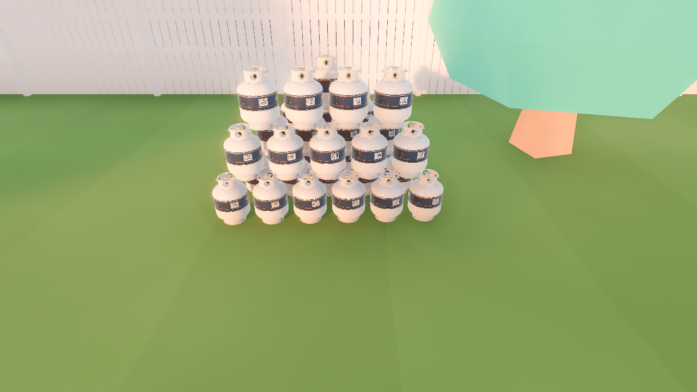
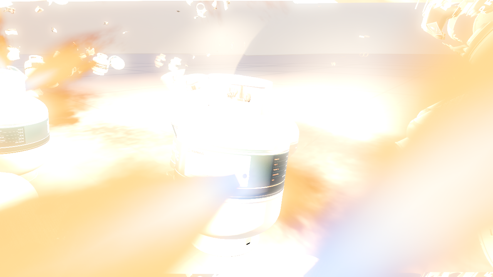
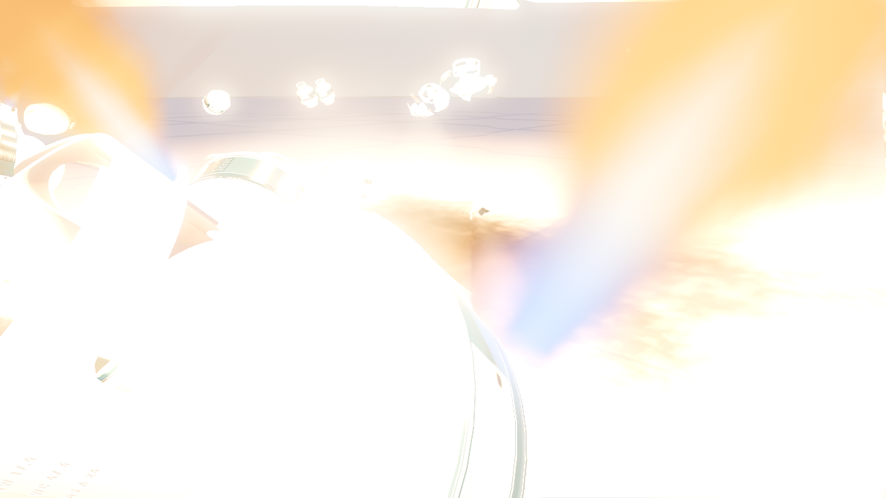
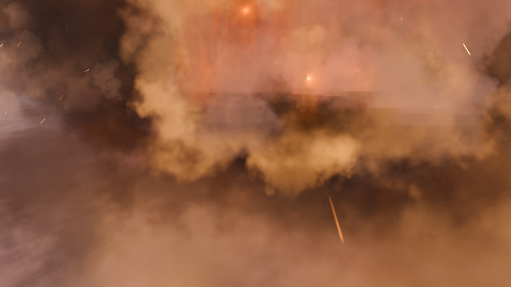
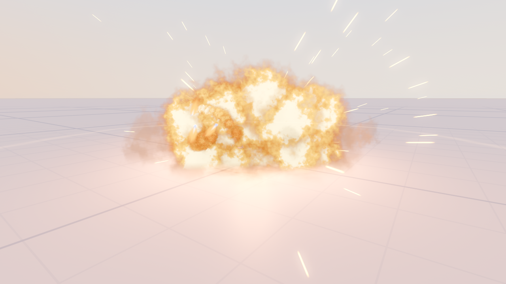

# Tank scaling

The performance work is substantial, but this branch **does not satisfy the complete acceptance brief**.
The ordinary 4× native Release match median is 66.5 fps with an 81.03 ms median maximum, but one of three runs
averages 55.6 fps. The official four-bot 4× disturbed view reaches 37.2 fps, dominated by navigation. The earlier
sixteen-client Debug and native Release gates failed; both final merged Debug sixteen-client soaks also fail. Treat the branch
as measured optimization work awaiting the bot/navigation and networking follow-ups, not as a proven 4×
capacity release. Failed runs remain in the evidence below.

`TankCountMultiplier` scales suburb tank supply and complete pile sizes from 1–8. The default stays at 1.
The baked single-player supply is 40, so the comparison grid is 40/80/160/320 tanks. Four-player matches have
36/72/144/288 map tanks; sixteen-player matches have 84/168/336/672. The Lab's square stack offers 24–512,
starting at 40. Initial tank hulls, contacts, mass, CCD and pile spacing retain their existing settings.

`TankSimulation` replaces individual tank physics callbacks with one world-owned callback. Intact tanks still
observe disturbances every physics tick. Vent thrust, fresh-owner correction suppression, gathering shimmer
and source retirement retain their paths. The batch checks each tank’s effective process mode;
Dissolve Run’s disabled tanks stop immediately even while their nodes await staged retirement. `GatherGroups` uses spatial cells while preserving the exact radius,
transitive connectivity, sorted membership and revision-based delay clocks.

Each blast still changes tank state, applies physical pushes, invokes player receivers and banks synchronously.
Gone shells lose their collision layers immediately rather than remaining in later same-frame blast queries.
Explosion geometry is shared. `ExplosionFullEffectBudget` retains 16 overlapping full effects; overflow keeps
the core flash and particle fireball. Slots return when the full effect exits its world.

`DebrisPiecesPerTank` selects six well-spread authored pieces instead of all 25. `DebrisQueue` records poses,
velocities and cosmetic randomness at the burst, then registers eight bodies per presentation frame.
Spawned fragments retain their convex hulls, CCD and persistent lifetime. Retired content discards queued work;
world invalidation clears it. A backlog visibly delays fragment breakup and its collisions. Raising the count
or registration dial can reproduce the previous cost; debris randomness now uses a separate cosmetic generator.

The engine still runs 120 Hz physics, with at most two catch-up steps per presentation frame. At 60 fps this
supplies every step. Under overload, simulation falls behind wall time; server deadlines still use their ordinary
monotonic clock. This deliberately sacrifices catch-up accuracy to prevent a burst from amplifying into a large
frame. No solver/contact reduction, tank hull replacement or distance-based tank freezing was introduced.

## Measurement method

The baseline is `91c97bb`; both scratch projects receive the same final `LabTest` measurement harness. Native Linux
Release exports select the Lab test as their main scene and include dev resources; gameplay code is otherwise the
corresponding baseline/candidate code. Debug uses the editor engine. Native Release is `ExportRelease`, not an
optimized assembly loaded into a Debug editor. Every invocation uses `godot-mono`; the invisible launcher selects
the exported executable through `PROPANE_REAL_GODOT`.

Cases alternate baseline/candidate, candidate/baseline, baseline/candidate across three repetitions. Each has
180 startup frames plus three additional simulated warm-up seconds, followed by four simulated seconds of idle
or a primed chain in the production square-pile fixture. The chain measurement includes the simultaneous puncture
and first detonation. Rendered runs use 1920×1080, disabled VSync, and no screenshot/recording during timing.
The candidate for this full grid is `71cd159` with the timed harness in `a7a38db`; the official merged-branch profile below checks the subsequent disabled-source integration fix. Every run retains raw CSV, engine log
and `uptime` before/after. Other packages can load the same machine.

`OS.LowProcessorUsageModeSleepUsec` and `Engine.MaxFps` are zero in the measurement harness. Rendered timing uses
the per-process `DISABLE_GAMESCOPE_WSI=1` switch from the [gamescope layer manifest](https://github.com/ValveSoftware/gamescope/blob/master/layer/VkLayer_FROG_gamescope_wsi.json.in).
The headless compositor still keeps runs invisible. Earlier samples with the default 6.9 ms headless idle wait
or forced VSync are excluded. The default measurement remains 600 frames when `--measure-seconds` is omitted.

```sh
godot-mono --headless --disable-vsync --resolution 1920x1080 res://scenes/dev/lab_test.tscn -- \
  --scenario=measure --count=160 --phase=chain --measure-warmup=3 --measure-seconds=4 \
  --metrics="$PWD/build/chain.csv"
# Rendered: omit --headless and set DISABLE_GAMESCOPE_WSI=1.
# Native Release: set PROPANE_REAL_GODOT to the scratch export and omit the scene argument.
```

FPS is frames divided by sampled wall time. Frame percentiles use nearest rank; the tables take the median of
each run's statistic, including its maximum. Tank/effect scopes are inclusive milliseconds per presentation
frame. `physics` is Godot's once-per-second physics peak monitor, not an isolated Jolt solver timer. GC totals
include the opt-in measurement collector. A quiet-machine remeasurement and exact native solver breakdown remain
the lead's follow-ups.


## Alternating pile comparison
All 192 invocations completed. The six baseline 8× rendered chain runs reached Godot’s 8,192 shader-instance limit; those rows are invalid and retain `FAIL` in [the run data](tank-scaling/runs.csv). All candidate runs were error-free. Every table cell is the median of three runs, not a pooled percentile. Times are milliseconds; GC is the **total pause duration over the window**, not the longest collection. Allocation and collection counts include the measurement collector.

### Release, headless, idle
| Scale | Build | FPS | Frame p50 | p95 | p99 | max | Physics monitor mean / max | Tank scope mean / max | GC total | Alloc MiB | GC 0/1/2 |
| --- | --- | ---: | ---: | ---: | ---: | ---: | ---: | ---: | ---: | ---: | --- |
| 1× (40) | before | 6462.3 | 0.14 | 0.20 | 0.38 | 17.87 | 0.570 / 1.808 | 0.0002 / 0.018 | 116.72 | 125.8 | 21/9/2 |
| 1× (40) | after | 6523.2 | 0.14 | 0.21 | 0.36 | 19.46 | 0.644 / 1.250 | 0.0002 / 0.024 | 115.83 | 127.9 | 21/9/3 |
| 2× (80) | before | 6464.9 | 0.14 | 0.21 | 0.40 | 15.31 | 0.814 / 2.000 | 0.0003 / 0.037 | 106.28 | 125.5 | 21/8/3 |
| 2× (80) | after | 6524.3 | 0.14 | 0.21 | 0.36 | 18.26 | 0.730 / 1.425 | 0.0004 / 0.043 | 112.24 | 127.3 | 21/9/2 |
| 4× (160) | before | 6685.7 | 0.13 | 0.20 | 0.44 | 15.92 | 0.581 / 0.879 | 0.0006 / 0.082 | 99.16 | 129.6 | 20/9/3 |
| 4× (160) | after | 6724.1 | 0.13 | 0.19 | 0.36 | 17.91 | 0.430 / 0.494 | 0.0007 / 0.110 | 107.30 | 130.7 | 21/9/2 |
| 8× (320) | before | 5283.0 | 0.17 | 0.23 | 0.76 | 17.05 | 1.185 / 2.111 | 0.0019 / 0.167 | 107.68 | 107.9 | 17/9/2 |
| 8× (320) | after | 5514.0 | 0.16 | 0.23 | 0.55 | 16.41 | 1.171 / 1.669 | 0.0021 / 0.169 | 105.96 | 112.0 | 18/9/2 |

### Release, headless, chain
| Scale | Build | FPS | Frame p50 | p95 | p99 | max | Physics monitor mean / max | Tank scope mean / max | GC total | Alloc MiB | GC 0/1/2 |
| --- | --- | ---: | ---: | ---: | ---: | ---: | ---: | ---: | ---: | ---: | --- |
| 1× (40) | before | 1187.2 | 0.60 | 2.54 | 3.78 | 64.45 | 9.034 / 36.086 | 0.0002 / 0.295 | 68.83 | 34.5 | 6/5/1 |
| 1× (40) | after | 4022.2 | 0.21 | 0.38 | 0.94 | 27.32 | 2.184 / 5.466 | 0.0001 / 0.374 | 90.71 | 95.3 | 14/8/2 |
| 2× (80) | before | 338.2 | 1.99 | 6.87 | 9.32 | 240.40 | 12.629 / 64.631 | 0.0008 / 0.347 | 80.45 | 28.3 | 5/4/0 |
| 2× (80) | after | 2169.5 | 0.35 | 1.29 | 1.82 | 34.20 | 3.436 / 8.806 | 0.0002 / 0.437 | 81.19 | 55.4 | 10/7/2 |
| 4× (160) | before | 51.3 | 0.35 | 89.78 | 254.93 | 389.36 | 6.307 / 90.806 | 0.0114 / 0.587 | 137.19 | 44.3 | 8/7/1 |
| 4× (160) | after | 1135.1 | 0.57 | 2.54 | 3.98 | 51.61 | 8.404 / 28.932 | 0.0008 / 0.533 | 67.95 | 35.7 | 7/6/1 |
| 8× (320) | before | 3.4 | 269.33 | 583.56 | 1070.49 | 1070.49 | 33.771 / 165.487 | 0.1988 / 2.278 | 365.82 | 85.5 | 16/15/3 |
| 8× (320) | after | 149.6 | 6.79 | 11.59 | 32.24 | 86.30 | 18.348 / 53.713 | 0.0166 / 1.107 | 89.33 | 24.7 | 4/3/0 |

### Release, rendered, idle
| Scale | Build | FPS | Frame p50 | p95 | p99 | max | Physics monitor mean / max | Tank scope mean / max | GC total | Alloc MiB | GC 0/1/2 |
| --- | --- | ---: | ---: | ---: | ---: | ---: | ---: | ---: | ---: | ---: | --- |
| 1× (40) | before | 141.6 | 6.77 | 9.55 | 12.36 | 25.45 | 1.940 / 4.451 | 0.0122 / 0.041 | 19.98 | 4.4 | 1/1/0 |
| 1× (40) | after | 143.5 | 6.75 | 8.55 | 11.88 | 30.71 | 1.777 / 3.513 | 0.0147 / 0.042 | 23.67 | 4.4 | 1/1/0 |
| 2× (80) | before | 136.0 | 7.08 | 11.04 | 13.03 | 13.88 | 1.250 / 1.902 | 0.0208 / 0.065 | 0.00 | 4.3 | 0/0/0 |
| 2× (80) | after | 129.9 | 7.00 | 12.71 | 13.49 | 15.08 | 1.210 / 1.884 | 0.0266 / 0.071 | 24.11 | 4.2 | 1/1/0 |
| 4× (160) | before | 93.0 | 11.61 | 14.25 | 15.54 | 17.62 | 4.310 / 15.192 | 0.0520 / 0.123 | 0.00 | 3.3 | 0/0/0 |
| 4× (160) | after | 133.7 | 7.33 | 8.98 | 12.08 | 14.61 | 6.130 / 21.047 | 0.0459 / 0.116 | 0.00 | 4.3 | 0/0/0 |
| 8× (320) | before | 119.6 | 7.85 | 12.21 | 14.42 | 16.35 | 2.580 / 23.840 | 0.0790 / 0.186 | 0.00 | 4.1 | 0/0/0 |
| 8× (320) | after | 124.5 | 7.77 | 10.27 | 12.80 | 15.08 | 1.897 / 15.956 | 0.1029 / 0.255 | 0.00 | 4.0 | 0/0/0 |

### Release, rendered, chain
| Scale | Build | FPS | Frame p50 | p95 | p99 | max | Physics monitor mean / max | Tank scope mean / max | GC total | Alloc MiB | GC 0/1/2 |
| --- | --- | ---: | ---: | ---: | ---: | ---: | ---: | ---: | ---: | ---: | --- |
| 1× (40) | before | 63.2 | 12.47 | 23.20 | 106.73 | 188.10 | 12.077 / 45.336 | 0.0049 / 0.805 | 34.98 | 10.7 | 2/1/0 |
| 1× (40) | after | 138.1 | 6.29 | 13.39 | 17.69 | 78.55 | 4.821 / 11.643 | 0.0039 / 0.887 | 36.02 | 6.7 | 2/1/0 |
| 2× (80) | before | 24.8 | 29.97 | 71.88 | 459.15 | 505.67 | 19.483 / 136.097 | 0.0180 / 1.030 | 84.62 | 21.8 | 4/3/1 |
| 2× (80) | after | 118.0 | 6.88 | 16.39 | 28.08 | 80.48 | 5.019 / 11.506 | 0.0055 / 0.748 | 33.45 | 8.3 | 2/1/0 |
| 4× (160) | before | 4.5 | 158.80 | 763.87 | 1462.49 | 1462.49 | 30.918 / 174.934 | 0.1012 / 1.400 | 146.47 | 43.9 | 7/5/2 |
| 4× (160) | after | 61.8 | 13.03 | 30.20 | 94.00 | 110.81 | 14.115 / 40.591 | 0.0168 / 1.073 | 7.84 | 10.9 | 1/0/0 |
| 8× (320) | before: invalid | — | — | — | — | — | — | — | — | — | — |
| 8× (320) | after | 33.7 | 16.63 | 112.16 | 344.35 | 389.04 | 27.821 / 176.337 | 0.0302 / 0.919 | 48.00 | 23.5 | 3/2/1 |

### Debug, headless, idle
| Scale | Build | FPS | Frame p50 | p95 | p99 | max | Physics monitor mean / max | Tank scope mean / max | GC total | Alloc MiB | GC 0/1/2 |
| --- | --- | ---: | ---: | ---: | ---: | ---: | ---: | ---: | ---: | ---: | --- |
| 1× (40) | before | 2965.8 | 0.29 | 0.47 | 0.82 | 20.87 | 1.270 / 2.118 | 0.0020 / 0.157 | 59.95 | 60.6 | 11/6/3 |
| 1× (40) | after | 3081.2 | 0.29 | 0.45 | 0.62 | 20.43 | 1.016 / 1.853 | 0.0019 / 0.112 | 59.48 | 62.2 | 11/6/3 |
| 2× (80) | before | 2882.6 | 0.29 | 0.47 | 1.03 | 22.14 | 1.543 / 2.263 | 0.0041 / 0.262 | 61.38 | 59.1 | 11/7/3 |
| 2× (80) | after | 3056.1 | 0.29 | 0.45 | 0.66 | 21.59 | 1.202 / 1.963 | 0.0037 / 0.225 | 59.69 | 61.4 | 11/6/3 |
| 4× (160) | before | 2483.8 | 0.31 | 0.69 | 1.69 | 22.52 | 2.068 / 3.234 | 0.0099 / 0.399 | 56.56 | 52.5 | 9/5/3 |
| 4× (160) | after | 2731.7 | 0.31 | 0.58 | 0.94 | 23.36 | 2.048 / 3.469 | 0.0089 / 1.063 | 59.95 | 56.5 | 10/7/3 |
| 8× (320) | before | 2289.5 | 0.30 | 2.20 | 2.42 | 26.98 | 3.296 / 3.646 | 0.0202 / 0.755 | 52.82 | 49.8 | 9/6/3 |
| 8× (320) | after | 2919.0 | 0.30 | 0.45 | 0.96 | 21.48 | 1.765 / 2.415 | 0.0153 / 0.954 | 61.23 | 60.2 | 11/6/3 |

### Debug, headless, chain
| Scale | Build | FPS | Frame p50 | p95 | p99 | max | Physics monitor mean / max | Tank scope mean / max | GC total | Alloc MiB | GC 0/1/2 |
| --- | --- | ---: | ---: | ---: | ---: | ---: | ---: | ---: | ---: | ---: | --- |
| 1× (40) | before | 251.7 | 3.65 | 7.91 | 11.67 | 131.05 | 12.718 / 64.772 | 0.0011 / 0.416 | 44.21 | 13.9 | 2/2/1 |
| 1× (40) | after | 970.4 | 0.96 | 1.94 | 2.62 | 38.75 | 4.001 / 8.402 | 0.0004 / 0.520 | 42.11 | 26.0 | 4/4/1 |
| 2× (80) | before | 46.5 | 9.28 | 43.86 | 96.62 | 418.51 | 9.606 / 66.465 | 0.0094 / 0.602 | 60.03 | 21.4 | 3/3/1 |
| 2× (80) | after | 450.5 | 2.00 | 4.12 | 6.05 | 47.96 | 8.526 / 32.499 | 0.0014 / 0.562 | 45.64 | 15.3 | 3/3/1 |
| 4× (160) | before | 7.1 | 170.72 | 311.83 | 812.30 | 812.30 | 24.163 / 131.329 | 0.0827 / 1.071 | 169.71 | 42.8 | 9/8/3 |
| 4× (160) | after | 149.6 | 6.90 | 9.84 | 16.53 | 69.28 | 13.700 / 37.497 | 0.0094 / 0.840 | 46.99 | 12.1 | 2/2/1 |
| 8× (320) | before | 2.8 | 321.24 | 585.40 | 1237.79 | 1237.79 | 36.769 / 190.539 | 0.2386 / 2.527 | 291.91 | 86.5 | 16/15/3 |
| 8× (320) | after | 77.5 | 10.92 | 21.42 | 47.98 | 94.05 | 31.930 / 60.229 | 0.0275 / 0.937 | 72.67 | 23.3 | 4/3/1 |

### Debug, rendered, idle
| Scale | Build | FPS | Frame p50 | p95 | p99 | max | Physics monitor mean / max | Tank scope mean / max | GC total | Alloc MiB | GC 0/1/2 |
| --- | --- | ---: | ---: | ---: | ---: | ---: | ---: | ---: | ---: | ---: | --- |
| 1× (40) | before | 141.6 | 6.88 | 8.59 | 11.86 | 24.56 | 1.579 / 2.322 | 0.0514 / 0.183 | 20.43 | 4.5 | 1/1/0 |
| 1× (40) | after | 143.1 | 6.84 | 7.88 | 11.68 | 24.94 | 5.258 / 17.705 | 0.0513 / 0.125 | 17.47 | 4.4 | 1/1/0 |
| 2× (80) | before | 141.0 | 6.94 | 8.54 | 12.04 | 19.95 | 2.265 / 3.429 | 0.0904 / 0.301 | 17.08 | 4.5 | 1/1/0 |
| 2× (80) | after | 139.0 | 6.93 | 8.80 | 12.29 | 29.00 | 7.059 / 22.654 | 0.1003 / 0.259 | 22.07 | 4.4 | 1/1/0 |
| 4× (160) | before | 133.3 | 7.34 | 9.70 | 12.32 | 15.34 | 10.497 / 29.013 | 0.2556 / 0.646 | 0.00 | 4.4 | 0/0/0 |
| 4× (160) | after | 136.1 | 7.20 | 9.18 | 12.62 | 29.73 | 2.844 / 3.934 | 0.2332 / 0.569 | 23.00 | 4.7 | 1/1/0 |
| 8× (320) | before | 91.4 | 9.27 | 17.03 | 20.72 | 34.71 | 9.690 / 34.369 | 1.0097 / 4.525 | 0.00 | 4.0 | 0/0/0 |
| 8× (320) | after | 121.5 | 7.94 | 11.56 | 14.12 | 23.56 | 11.241 / 33.746 | 0.6203 / 2.492 | 0.00 | 4.0 | 0/0/0 |

### Debug, rendered, chain
| Scale | Build | FPS | Frame p50 | p95 | p99 | max | Physics monitor mean / max | Tank scope mean / max | GC total | Alloc MiB | GC 0/1/2 |
| --- | --- | ---: | ---: | ---: | ---: | ---: | ---: | ---: | ---: | ---: | --- |
| 1× (40) | before | 53.7 | 16.70 | 25.05 | 89.85 | 193.45 | 14.273 / 48.678 | 0.0078 / 1.069 | 23.23 | 10.4 | 2/1/0 |
| 1× (40) | after | 137.8 | 6.60 | 13.02 | 17.37 | 76.74 | 4.296 / 10.135 | 0.0040 / 0.757 | 25.80 | 6.2 | 2/1/0 |
| 2× (80) | before | 5.1 | 132.37 | 228.13 | 870.67 | 870.67 | 29.881 / 221.038 | 0.0944 / 2.027 | 108.70 | 21.4 | 4/3/1 |
| 2× (80) | after | 94.0 | 8.87 | 18.27 | 36.56 | 95.61 | 8.249 / 17.565 | 0.0096 / 1.080 | 29.15 | 7.1 | 2/1/0 |
| 4× (160) | before | 2.7 | 271.99 | 621.95 | 2036.02 | 2036.02 | 40.091 / 251.403 | 0.2075 / 3.697 | 212.59 | 43.9 | 9/7/3 |
| 4× (160) | after | 37.7 | 22.56 | 54.47 | 113.28 | 147.58 | 16.663 / 45.149 | 0.0323 / 1.333 | 30.86 | 10.9 | 2/1/0 |
| 8× (320) | before: invalid | — | — | — | — | — | — | — | — | — | — |
| 8× (320) | after | 28.0 | 21.39 | 119.94 | 353.94 | 400.64 | 29.245 / 181.178 | 0.0466 / 1.264 | 47.57 | 23.3 | 3/2/1 |

## Landed scale benchmark

After `make bench` landed, `e7ff766` was merged into the candidate (`e0898fc`). A detached baseline checkout inside `build/` used `e7ff766`. The official runner measured 168 alternating baseline/candidate runs: three repetitions, 2 simulated seconds plus 0.5 seconds of warm-up, with its default seed-23 254 m suburb and 1280×720 overview. Zero-bot cases cover 1/2/4/8×, Debug/Release and both views; 4/8/16-bot stress cases cover 4/8× Release in both views. These short stage windows expose costs but do not establish long-run capacity. Every run passed the runner’s assembly, pacing, coverage and engine-log validation. `bench_compare.py --merge` and comparison passed for both configurations; compared plan hashes agree.

`intact` and `disturbed` are the official stages: halfway through, every fourth surviving tank is punctured. Bots can already have caused explosions. These are many normal-sized piles, unlike the dense primed-chain fixture above. Release here means optimized C# on the editor engine; the dense-chain grid above uses native export templates. Physics is the callback interval plus native tail per tick; Jolt≤ is the native-tail upper bound, not an isolated solver timer. Tank and brain scopes are inclusive per physics tick. GC is total pause over the whole two-second run and is repeated across stage rows. All values are medians of three run statistics. [Individual results, loads, actual ticks and remaining supply](tank-scaling/official-runs.csv).

Commands used the official `tools/dev/bench.py` with `--config=Debug|Release --rendered=0|1 --bots=0|4|8|16 --tanks=1|2|4|8 --seconds=2 --warmup=0.5 --repeats=1 --output=...`, alternating A/B, B/A, A/B for each case. `make bench CONFIG=Release BOTS=0 TANKS=1 RENDERED=0 SECONDS=0.5 WARMUP=0.5 REPEATS=1` also passed the integration smoke.

### Tank-only stages

| Config / view | Bots | Scale | Stage | Build | FPS | Frame p50 / p95 / p99 / max ms | Physics / Jolt≤ ms per tick | Tank / brain ms per tick | Nav % of brain | GC total ms |
| --- | ---: | ---: | --- | --- | ---: | ---: | ---: | ---: | ---: | ---: |
| Debug / headless | 0 | 1× | disturbed | before | 2985.2 | 0.29 / 0.43 / 0.92 / 32.90 | 0.787 / 0.184 | 0.051 / 0.000 | 0.0 | 20.19 |
| Debug / headless | 0 | 1× | disturbed | after | 3012.1 | 0.29 / 0.44 / 0.75 / 33.70 | 0.656 / 0.183 | 0.054 / 0.000 | 0.0 | 12.61 |
| Debug / headless | 0 | 1× | intact | before | 3495.3 | 0.26 / 0.38 / 0.76 / 21.65 | 0.474 / 0.135 | 0.051 / 0.000 | 0.0 | 20.19 |
| Debug / headless | 0 | 1× | intact | after | 3575.5 | 0.25 / 0.38 / 0.59 / 13.35 | 0.301 / 0.136 | 0.054 / 0.000 | 0.0 | 12.61 |
| Debug / headless | 0 | 2× | disturbed | before | 2400.8 | 0.34 / 0.83 / 1.45 / 34.76 | 1.138 / 0.242 | 0.097 / 0.000 | 0.0 | 0.00 |
| Debug / headless | 0 | 2× | disturbed | after | 2571.2 | 0.33 / 0.51 / 0.98 / 34.17 | 0.797 / 0.253 | 0.097 / 0.000 | 0.0 | 7.07 |
| Debug / headless | 0 | 2× | intact | before | 3388.7 | 0.26 / 0.38 / 1.02 / 1.75 | 0.728 / 0.147 | 0.101 / 0.000 | 0.0 | 0.00 |
| Debug / headless | 0 | 2× | intact | after | 3567.7 | 0.26 / 0.38 / 0.65 / 1.75 | 0.359 / 0.136 | 0.106 / 0.000 | 0.0 | 7.07 |
| Debug / headless | 0 | 4× | disturbed | before | 1616.3 | 0.42 / 2.13 / 2.75 / 41.40 | 1.850 / 0.352 | 0.192 / 0.000 | 0.0 | 12.63 |
| Debug / headless | 0 | 4× | disturbed | after | 1774.3 | 0.43 / 1.40 / 1.82 / 69.83 | 1.310 / 0.345 | 0.193 / 0.000 | 0.0 | 25.75 |
| Debug / headless | 0 | 4× | intact | before | 3029.0 | 0.26 / 0.41 / 1.55 / 2.63 | 1.222 / 0.153 | 0.203 / 0.000 | 0.0 | 12.63 |
| Debug / headless | 0 | 4× | intact | after | 3247.1 | 0.27 / 0.40 / 0.82 / 2.03 | 0.513 / 0.161 | 0.218 / 0.000 | 0.0 | 25.75 |
| Debug / headless | 0 | 8× | disturbed | before | 768.0 | 0.73 / 3.92 / 5.27 / 48.59 | 2.838 / 0.491 | 0.368 / 0.000 | 0.0 | 0.00 |
| Debug / headless | 0 | 8× | disturbed | after | 886.1 | 0.78 / 2.60 / 3.10 / 77.86 | 1.620 / 0.491 | 0.371 / 0.000 | 0.0 | 25.19 |
| Debug / headless | 0 | 8× | intact | before | 2648.2 | 0.26 / 0.43 / 2.53 / 5.24 | 2.208 / 0.149 | 0.427 / 0.000 | 0.0 | 0.00 |
| Debug / headless | 0 | 8× | intact | after | 3113.1 | 0.28 / 0.42 / 1.06 / 2.90 | 0.743 / 0.166 | 0.432 / 0.000 | 0.0 | 25.19 |
| Debug / rendered | 0 | 1× | disturbed | before | 199.6 | 4.65 / 5.56 / 7.82 / 64.63 | 1.149 / 0.209 | 0.057 / 0.000 | 0.0 | 0.00 |
| Debug / rendered | 0 | 1× | disturbed | after | 197.6 | 4.71 / 5.36 / 9.15 / 67.72 | 1.011 / 0.206 | 0.061 / 0.000 | 0.0 | 0.00 |
| Debug / rendered | 0 | 1× | intact | before | 223.3 | 4.50 / 5.13 / 5.91 / 6.63 | 0.576 / 0.152 | 0.054 / 0.000 | 0.0 | 0.00 |
| Debug / rendered | 0 | 1× | intact | after | 223.1 | 4.49 / 4.96 / 5.52 / 7.03 | 0.410 / 0.157 | 0.057 / 0.000 | 0.0 | 0.00 |
| Debug / rendered | 0 | 2× | disturbed | before | 194.4 | 4.72 / 5.91 / 14.14 / 67.65 | 1.439 / 0.239 | 0.094 / 0.000 | 0.0 | 0.00 |
| Debug / rendered | 0 | 2× | disturbed | after | 195.5 | 4.72 / 5.55 / 9.40 / 68.60 | 1.127 / 0.236 | 0.104 / 0.000 | 0.0 | 0.00 |
| Debug / rendered | 0 | 2× | intact | before | 221.9 | 4.49 / 5.39 / 6.09 / 6.26 | 0.797 / 0.149 | 0.100 / 0.000 | 0.0 | 0.00 |
| Debug / rendered | 0 | 2× | intact | after | 221.7 | 4.50 / 5.02 / 5.72 / 5.97 | 0.455 / 0.151 | 0.104 / 0.000 | 0.0 | 0.00 |
| Debug / rendered | 0 | 4× | disturbed | before | 114.2 | 7.28 / 12.24 / 22.39 / 69.38 | 2.004 / 0.328 | 0.173 / 0.000 | 0.0 | 0.00 |
| Debug / rendered | 0 | 4× | disturbed | after | 121.8 | 6.92 / 11.72 / 13.86 / 75.22 | 1.394 / 0.317 | 0.193 / 0.000 | 0.0 | 0.00 |
| Debug / rendered | 0 | 4× | intact | before | 139.5 | 6.86 / 11.62 / 12.16 / 12.21 | 1.244 / 0.153 | 0.194 / 0.000 | 0.0 | 0.00 |
| Debug / rendered | 0 | 4× | intact | after | 210.1 | 4.56 / 7.18 / 10.04 / 11.92 | 0.581 / 0.155 | 0.209 / 0.000 | 0.0 | 0.00 |
| Debug / rendered | 0 | 8× | disturbed | before | 102.5 | 8.46 / 11.92 / 39.35 / 79.17 | 2.990 / 0.459 | 0.322 / 0.000 | 0.0 | 0.00 |
| Debug / rendered | 0 | 8× | disturbed | after | 134.6 | 6.88 / 8.46 / 17.48 / 79.98 | 1.636 / 0.396 | 0.340 / 0.000 | 0.0 | 0.00 |
| Debug / rendered | 0 | 8× | intact | before | 218.6 | 4.55 / 6.96 / 7.50 / 8.15 | 2.064 / 0.137 | 0.373 / 0.000 | 0.0 | 0.00 |
| Debug / rendered | 0 | 8× | intact | after | 219.3 | 4.55 / 5.36 / 6.27 / 6.65 | 0.699 / 0.133 | 0.382 / 0.000 | 0.0 | 0.00 |
| Release / headless | 0 | 1× | disturbed | before | 3202.4 | 0.28 / 0.32 / 0.84 / 35.05 | 0.761 / 0.203 | 0.042 / 0.000 | 0.0 | 5.27 |
| Release / headless | 0 | 1× | disturbed | after | 3259.2 | 0.27 / 0.33 / 0.69 / 31.56 | 0.572 / 0.198 | 0.043 / 0.000 | 0.0 | 31.20 |
| Release / headless | 0 | 1× | intact | before | 3814.3 | 0.25 / 0.29 / 0.69 / 1.49 | 0.399 / 0.114 | 0.045 / 0.000 | 0.0 | 5.27 |
| Release / headless | 0 | 1× | intact | after | 4031.5 | 0.24 / 0.28 / 0.54 / 4.60 | 0.261 / 0.114 | 0.043 / 0.000 | 0.0 | 31.20 |
| Release / headless | 0 | 2× | disturbed | before | 2883.3 | 0.30 / 0.36 / 1.14 / 29.89 | 0.967 / 0.234 | 0.076 / 0.000 | 0.0 | 22.73 |
| Release / headless | 0 | 2× | disturbed | after | 2964.2 | 0.30 / 0.35 / 0.85 / 31.11 | 0.689 / 0.225 | 0.076 / 0.000 | 0.0 | 22.37 |
| Release / headless | 0 | 2× | intact | before | 3844.0 | 0.23 / 0.28 / 0.88 / 24.57 | 0.588 / 0.113 | 0.087 / 0.000 | 0.0 | 22.73 |
| Release / headless | 0 | 2× | intact | after | 4010.5 | 0.24 / 0.28 / 0.57 / 22.74 | 0.291 / 0.115 | 0.084 / 0.000 | 0.0 | 22.37 |
| Release / headless | 0 | 4× | disturbed | before | 2102.0 | 0.37 / 1.61 / 1.84 / 34.17 | 1.493 / 0.286 | 0.138 / 0.000 | 0.0 | 10.24 |
| Release / headless | 0 | 4× | disturbed | after | 2145.3 | 0.39 / 1.08 / 1.41 / 36.35 | 0.932 / 0.295 | 0.160 / 0.000 | 0.0 | 29.03 |
| Release / headless | 0 | 4× | intact | before | 3581.2 | 0.24 / 0.29 / 1.27 / 12.01 | 0.988 / 0.119 | 0.170 / 0.000 | 0.0 | 10.24 |
| Release / headless | 0 | 4× | intact | after | 3586.2 | 0.25 / 0.35 / 0.74 / 3.91 | 0.458 / 0.138 | 0.196 / 0.000 | 0.0 | 29.03 |
| Release / headless | 0 | 8× | disturbed | before | 1086.0 | 0.60 / 3.03 / 3.44 / 41.36 | 2.348 / 0.399 | 0.266 / 0.000 | 0.0 | 22.09 |
| Release / headless | 0 | 8× | disturbed | after | 1309.7 | 0.61 / 1.82 / 2.21 / 42.10 | 1.165 / 0.393 | 0.271 / 0.000 | 0.0 | 5.75 |
| Release / headless | 0 | 8× | intact | before | 3233.1 | 0.23 / 0.29 / 2.02 / 24.04 | 1.741 / 0.114 | 0.322 / 0.000 | 0.0 | 22.09 |
| Release / headless | 0 | 8× | intact | after | 3865.2 | 0.24 / 0.28 / 0.82 / 2.28 | 0.552 / 0.125 | 0.332 / 0.000 | 0.0 | 5.75 |
| Release / rendered | 0 | 1× | disturbed | before | 201.0 | 4.62 / 5.47 / 7.57 / 59.88 | 0.997 / 0.182 | 0.047 / 0.000 | 0.0 | 0.00 |
| Release / rendered | 0 | 1× | disturbed | after | 201.7 | 4.66 / 5.21 / 6.92 / 60.39 | 0.875 / 0.181 | 0.051 / 0.000 | 0.0 | 0.00 |
| Release / rendered | 0 | 1× | intact | before | 223.0 | 4.45 / 5.07 / 5.74 / 6.03 | 0.507 / 0.136 | 0.048 / 0.000 | 0.0 | 0.00 |
| Release / rendered | 0 | 1× | intact | after | 223.4 | 4.46 / 4.91 / 5.45 / 5.80 | 0.349 / 0.132 | 0.050 / 0.000 | 0.0 | 0.00 |
| Release / rendered | 0 | 2× | disturbed | before | 106.0 | 9.06 / 11.10 / 14.15 / 70.60 | 1.418 / 0.255 | 0.091 / 0.000 | 0.0 | 0.00 |
| Release / rendered | 0 | 2× | disturbed | after | 197.3 | 4.70 / 5.53 / 9.63 / 63.98 | 1.066 / 0.231 | 0.095 / 0.000 | 0.0 | 0.00 |
| Release / rendered | 0 | 2× | intact | before | 129.2 | 8.46 / 10.26 / 11.08 / 13.43 | 0.803 / 0.163 | 0.099 / 0.000 | 0.0 | 0.00 |
| Release / rendered | 0 | 2× | intact | after | 222.4 | 4.47 / 5.04 / 5.67 / 5.96 | 0.452 / 0.150 | 0.102 / 0.000 | 0.0 | 0.00 |
| Release / rendered | 0 | 4× | disturbed | before | 186.6 | 4.83 / 6.55 / 19.26 / 66.78 | 1.795 / 0.285 | 0.150 / 0.000 | 0.0 | 0.00 |
| Release / rendered | 0 | 4× | disturbed | after | 190.9 | 4.81 / 5.94 / 10.54 / 66.64 | 1.207 / 0.276 | 0.162 / 0.000 | 0.0 | 0.00 |
| Release / rendered | 0 | 4× | intact | before | 221.7 | 4.48 / 5.72 / 6.35 / 6.81 | 1.128 / 0.135 | 0.178 / 0.000 | 0.0 | 0.00 |
| Release / rendered | 0 | 4× | intact | after | 221.9 | 4.47 / 5.10 / 5.84 / 6.03 | 0.496 / 0.132 | 0.188 / 0.000 | 0.0 | 0.00 |
| Release / rendered | 0 | 8× | disturbed | before | 22.6 | 24.75 / 125.10 / 139.05 / 139.05 | 7.133 / 2.382 | 0.608 / 0.000 | 0.0 | 14.83 |
| Release / rendered | 0 | 8× | disturbed | after | 132.7 | 6.95 / 8.75 / 30.53 / 83.67 | 1.787 / 0.413 | 0.345 / 0.000 | 0.0 | 11.18 |
| Release / rendered | 0 | 8× | intact | before | 217.2 | 4.50 / 6.89 / 7.50 / 8.46 | 1.982 / 0.153 | 0.364 / 0.000 | 0.0 | 14.83 |
| Release / rendered | 0 | 8× | intact | after | 218.5 | 4.50 / 5.95 / 6.99 / 10.24 | 0.797 / 0.153 | 0.402 / 0.000 | 0.0 | 11.18 |

### Bot stress stages (Release)

| Config / view | Bots | Scale | Stage | Build | FPS | Frame p50 / p95 / p99 / max ms | Physics / Jolt≤ ms per tick | Tank / brain ms per tick | Nav % of brain | GC total ms |
| --- | ---: | ---: | --- | --- | ---: | ---: | ---: | ---: | ---: | ---: |
| Release / headless | 4 | 4× | disturbed | before | 3.9 | 232.34 / 554.50 / 554.50 / 554.50 | 20.614 / 3.563 | 0.262 / 15.271 | 93.7 | 439.01 |
| Release / headless | 4 | 4× | disturbed | after | 36.4 | 17.62 / 79.79 / 165.72 / 165.72 | 16.063 / 1.900 | 0.228 / 13.015 | 93.8 | 286.74 |
| Release / headless | 4 | 4× | intact | before | 4.6 | 170.16 / 517.69 / 517.69 / 517.69 | 17.453 / 4.199 | 0.416 / 9.630 | 89.1 | 439.01 |
| Release / headless | 4 | 4× | intact | after | 68.6 | 2.86 / 58.15 / 97.07 / 112.81 | 12.862 / 1.206 | 0.346 / 9.835 | 87.3 | 286.74 |
| Release / headless | 4 | 8× | disturbed | before | 4.0 | 221.80 / 433.09 / 433.09 / 433.09 | 20.229 / 3.334 | 0.337 / 14.013 | 90.0 | 203.73 |
| Release / headless | 4 | 8× | disturbed | after | 85.2 | 2.56 / 58.34 / 123.61 / 135.83 | 12.465 / 1.923 | 0.341 / 9.511 | 76.8 | 138.91 |
| Release / headless | 4 | 8× | intact | before | 15.8 | 47.06 / 162.75 / 217.45 / 217.45 | 9.205 / 1.723 | 0.451 / 4.169 | 41.5 | 203.73 |
| Release / headless | 4 | 8× | intact | after | 381.7 | 1.34 / 5.14 / 29.46 / 56.82 | 4.231 / 0.372 | 0.373 / 2.674 | 17.1 | 138.91 |
| Release / headless | 8 | 4× | disturbed | before | 6.5 | 157.38 / 324.53 / 324.53 / 324.53 | 13.815 / 2.861 | 0.145 / 9.339 | 88.9 | 280.99 |
| Release / headless | 8 | 4× | disturbed | after | 44.0 | 19.55 / 53.38 / 63.70 / 65.32 | 10.978 / 0.981 | 0.144 / 9.254 | 88.7 | 269.88 |
| Release / headless | 8 | 4× | intact | before | 7.0 | 124.45 / 237.89 / 237.89 / 237.89 | 11.934 / 0.927 | 0.177 / 8.555 | 87.1 | 280.99 |
| Release / headless | 8 | 4× | intact | after | 46.9 | 17.76 / 55.09 / 82.53 / 82.53 | 12.142 / 0.641 | 0.190 / 10.168 | 85.4 | 269.88 |
| Release / headless | 8 | 8× | disturbed | before | 3.0 | 303.85 / 489.13 / 489.13 / 489.13 | 27.329 / 3.757 | 0.295 / 20.861 | 87.8 | 263.77 |
| Release / headless | 8 | 8× | disturbed | after | 28.0 | 29.25 / 74.80 / 106.03 / 106.03 | 17.052 / 1.327 | 0.292 / 14.547 | 83.2 | 171.59 |
| Release / headless | 8 | 8× | intact | before | 10.7 | 87.58 / 270.78 / 270.78 / 270.78 | 9.569 / 1.494 | 0.366 / 4.948 | 38.2 | 263.77 |
| Release / headless | 8 | 8× | intact | after | 92.3 | 5.41 / 44.73 / 54.48 / 59.85 | 8.511 / 0.509 | 0.361 / 6.533 | 53.6 | 171.59 |
| Release / headless | 16 | 4× | disturbed | before | 4.0 | 242.33 / 372.88 / 372.88 / 372.88 | 19.760 / 5.311 | 0.177 / 11.774 | 81.6 | 408.38 |
| Release / headless | 16 | 4× | disturbed | after | 23.8 | 36.91 / 82.09 / 95.51 / 95.51 | 16.341 / 1.864 | 0.168 / 12.752 | 81.8 | 450.01 |
| Release / headless | 16 | 4× | intact | before | 4.1 | 260.45 / 388.59 / 388.59 / 388.59 | 19.739 / 3.062 | 0.229 / 12.515 | 76.8 | 408.38 |
| Release / headless | 16 | 4× | intact | after | 22.7 | 40.56 / 79.28 / 88.13 / 88.13 | 18.421 / 1.180 | 0.215 / 15.372 | 80.8 | 450.01 |
| Release / headless | 16 | 8× | disturbed | before | 1.8 | 561.57 / 705.25 / 705.25 / 705.25 | 46.183 / 5.834 | 0.420 / 35.705 | 82.2 | 547.80 |
| Release / headless | 16 | 8× | disturbed | after | 10.6 | 86.07 / 152.68 / 204.76 / 204.76 | 42.634 / 2.384 | 0.364 / 37.960 | 84.6 | 597.84 |
| Release / headless | 16 | 8× | intact | before | 4.0 | 267.68 / 329.92 / 329.92 / 329.92 | 20.333 / 2.422 | 0.481 / 13.068 | 55.0 | 547.80 |
| Release / headless | 16 | 8× | intact | after | 19.7 | 38.87 / 150.94 / 182.72 / 182.72 | 21.623 / 1.234 | 0.453 / 18.216 | 62.3 | 597.84 |
| Release / rendered | 4 | 4× | disturbed | before | 6.0 | 151.82 / 276.74 / 276.74 / 276.74 | 12.937 / 2.417 | 0.157 / 8.912 | 94.0 | 276.07 |
| Release / rendered | 4 | 4× | disturbed | after | 37.2 | 24.86 / 53.91 / 78.39 / 78.39 | 9.464 / 1.013 | 0.166 / 7.616 | 94.0 | 195.78 |
| Release / rendered | 4 | 4× | intact | before | 6.9 | 105.69 / 313.19 / 313.19 / 313.19 | 13.192 / 2.166 | 0.216 / 7.723 | 88.9 | 276.07 |
| Release / rendered | 4 | 4× | intact | after | 53.7 | 11.73 / 43.43 / 109.45 / 109.45 | 8.468 / 0.497 | 0.199 / 6.471 | 89.4 | 195.78 |
| Release / rendered | 4 | 8× | disturbed | before | 4.4 | 218.87 / 379.89 / 379.89 / 379.89 | 17.389 / 2.995 | 0.314 / 12.007 | 90.1 | 191.83 |
| Release / rendered | 4 | 8× | disturbed | after | 38.5 | 20.12 / 51.32 / 74.02 / 74.02 | 6.700 / 1.318 | 0.295 / 4.152 | 67.4 | 60.71 |
| Release / rendered | 4 | 8× | intact | before | 14.4 | 60.14 / 183.43 / 193.22 / 193.22 | 8.605 / 1.643 | 0.394 / 3.485 | 30.4 | 191.83 |
| Release / rendered | 4 | 8× | intact | after | 108.6 | 7.23 / 25.43 / 32.83 / 82.03 | 3.694 / 0.325 | 0.377 / 1.922 | 12.8 | 60.71 |
| Release / rendered | 8 | 4× | disturbed | before | 5.1 | 203.50 / 335.88 / 335.88 / 335.88 | 15.115 / 3.696 | 0.146 / 9.757 | 90.2 | 303.99 |
| Release / rendered | 8 | 4× | disturbed | after | 29.4 | 31.56 / 59.41 / 79.15 / 79.15 | 11.785 / 1.174 | 0.138 / 9.750 | 88.0 | 267.99 |
| Release / rendered | 8 | 4× | intact | before | 6.3 | 138.50 / 256.37 / 256.37 / 256.37 | 12.510 / 1.090 | 0.173 / 8.826 | 88.6 | 303.99 |
| Release / rendered | 8 | 4× | intact | after | 34.5 | 25.88 / 59.84 / 89.84 / 89.84 | 11.224 / 0.638 | 0.173 / 9.145 | 87.2 | 267.99 |
| Release / rendered | 8 | 8× | disturbed | before | 2.3 | 399.43 / 524.53 / 524.53 / 524.53 | 33.906 / 5.611 | 0.385 / 24.856 | 88.4 | 361.96 |
| Release / rendered | 8 | 8× | disturbed | after | 20.1 | 41.58 / 89.90 / 110.59 / 110.59 | 16.897 / 2.192 | 0.299 / 13.354 | 81.1 | 192.38 |
| Release / rendered | 8 | 8× | intact | before | 5.9 | 143.68 / 354.71 / 354.71 / 354.71 | 13.167 / 2.557 | 0.453 / 6.357 | 39.4 | 361.96 |
| Release / rendered | 8 | 8× | intact | after | 40.8 | 15.79 / 59.26 / 88.12 / 88.12 | 9.226 / 0.709 | 0.368 / 6.654 | 52.4 | 192.38 |
| Release / rendered | 16 | 4× | disturbed | before | 3.2 | 314.40 / 460.31 / 460.31 / 460.31 | 23.550 / 6.777 | 0.195 / 13.270 | 82.0 | 423.43 |
| Release / rendered | 16 | 4× | disturbed | after | 14.9 | 58.20 / 129.06 / 143.16 / 143.16 | 22.255 / 2.921 | 0.185 / 16.715 | 85.4 | 428.90 |
| Release / rendered | 16 | 4× | intact | before | 3.4 | 307.32 / 393.52 / 393.52 / 393.52 | 22.535 / 4.259 | 0.257 / 13.236 | 77.1 | 423.43 |
| Release / rendered | 16 | 4× | intact | after | 20.6 | 46.81 / 77.28 / 86.76 / 86.76 | 15.800 / 1.537 | 0.227 / 11.994 | 74.3 | 428.90 |
| Release / rendered | 16 | 8× | disturbed | before | 1.8 | 526.47 / 691.92 / 691.92 / 691.92 | 43.770 / 5.722 | 0.366 / 34.367 | 82.1 | 475.30 |
| Release / rendered | 16 | 8× | disturbed | after | 11.5 | 76.30 / 157.05 / 182.87 / 182.87 | 32.803 / 2.553 | 0.357 / 28.138 | 80.0 | 476.20 |
| Release / rendered | 16 | 8× | intact | before | 3.9 | 269.41 / 395.38 / 395.38 / 395.38 | 20.060 / 2.181 | 0.430 / 12.820 | 54.6 | 475.30 |
| Release / rendered | 16 | 8× | intact | after | 18.7 | 49.43 / 141.16 / 168.02 / 168.02 | 20.371 / 1.112 | 0.410 / 16.664 | 64.9 | 476.20 |

The overall 60 fps goal is **not met** with the current production bots. At 4× with four bots rendered, the disturbed candidate is 37.2 fps (p95 53.91 ms), tank scope 0.166 ms/tick, brain 7.616 ms/tick, 94.0% navigation. With sixteen bots it is 14.9 fps (p95 129.06 ms), tank 0.185 ms/tick, brain 16.715 ms/tick, 85.4% navigation. At 8× and sixteen bots it is 11.5 fps with p95 157.05 ms. These measurements identify the dependency on the separately owned bot/navigation optimization; no files in that package were edited here. Tank script time itself is approximately unchanged: the batch removes native per-node dispatch, but each tank still performs its disturbance checks and now checks effective process eligibility.

## Ordinary match in native Release

Three additional 90-second clean matches used the default capacity of five actors, seed 23, 160 map tanks (4×), and `--melee-start`. All clients used the native Linux ExportRelease fixture; one client rendered at 1920×1080, the other four were headless. Gameplay code matches `e0898fc`; the fixture changes only the main scene/export filter, bakes the 4× dial, and removes NetTest’s 60 fps cap/idle wait on the rendered client. Headless clients retain the harness cap. `--frame-metrics` records the primary view; samples are trimmed to the shared monotonic playing-phase bounds with 0.1-second margins, excluding construction, countdown and results. [Per-run frame results and uptime](tank-scaling/normal-release.csv).

| Run | FPS | Frame p50 / p95 / p99 / max ms | Mean GPU ms | Mean tank scope ms/frame |
| --- | ---: | ---: | ---: | ---: |
| 1 | 78.4 | 11.46 / 21.68 / 32.69 / 75.21 | 10.85 | 0.042 |
| 2 | 66.5 | 13.19 / 26.14 / 48.31 / 81.03 | 10.45 | 0.044 |
| 3 | 55.6 | 16.24 / 31.53 / 47.72 / 97.90 | 11.07 | 0.091 |
| Median | 66.5 | 13.19 / 26.14 / 47.72 / 81.03 | — | — |

All three runs passed the unchanged clean tank checker, all five clients agreed with the server’s bank audit, and engine logs were clean. The medians are encouraging but **do not prove a reliable 60 fps floor**: the third run averaged 55.6 fps and frame p95 was 26.15 ms at the median. Every sampled maximum was below 100 ms (75.21/81.03/97.90 ms). There is no paired native ordinary-match baseline, so these are candidate capacity observations, not an attributed speedup. The alternating dense-pile and official scale grids provide the before/after comparisons.

Each invocation used `tools/dev/net_bots.sh -g "$PWD/build/tanks-native-net.sh" -n 5 -w 1 -l 90 -t clean -p 24682 -s "--match-seed=23 --tune.MaxPlayers=16" -- --melee-start --frame-metrics="$out/metrics"`. The scratch wrapper selects the export through `PROPANE_REAL_GODOT`, strips unsupported scene overrides, and sets the rendered resolution; it still invokes `godot-mono`. The three repetitions were separate processes and recorded `uptime` before and after.

## Network scale gates

The required sixteen-client scale gate is **not met**. Six 90-second Debug soaks and six native Linux ExportRelease soaks used seed 23, `--melee-start`, 4× supply, 4/8/16 separate client processes, and the unmodified clean/faulted checker profiles. Faults were `--net-seed=2 --net-lag=120 --net-jitter=30 --net-loss=3`. All completed four- and eight-client soaks passed, with agreeing server/client bank audits and zero logged engine errors. Sixteen-client Debug runs failed tank convergence. Sixteen-client Release clean lost Bot11 during play; its coverage and final-score checks failed. Release faulted completed with agreeing scores but failed convergence. No tolerance or readiness checks were relaxed. [Per-run results and loads](tank-scaling/net-runs.csv).

| Config | Clients / map tanks | Profile | Result | Final rest / moving (m) | Longest episode (s) | Tank disagreements | Bank audits agree | Engine errors |
| --- | ---: | --- | --- | ---: | ---: | ---: | --- | ---: |
| Debug | 4 / 144 | clean | PASS | 0.000 / 0.074 | 1.05 | 0 | True | 0 |
| Debug | 4 / 144 | faults | PASS | 0.000 / 0.165 | 0.60 | 0 | True | 0 |
| Debug | 8 / 208 | clean | PASS | 0.001 / 0.177 | 1.45 | 0 | True | 0 |
| Debug | 8 / 208 | faults | PASS | 0.006 / 0.423 | 0.90 | 0 | True | 0 |
| Debug | 16 / 336 | clean | FAIL | 0.015 / 0.429 | 2.45 | 105 | True | 0 |
| Debug | 16 / 336 | faults | FAIL | 0.003 / 2.933 | 17.40 | 1296 | True | 0 |
| Release | 4 / 144 | clean | PASS | 0.000 / 0.292 | 0.20 | 0 | True | 0 |
| Release | 4 / 144 | faults | PASS | 0.001 / 0.200 | 0.70 | 0 | True | 0 |
| Release | 8 / 208 | clean | PASS | 0.095 / 0.101 | 0.75 | 0 | True | 0 |
| Release | 8 / 208 | faults | PASS | 0.000 / 0.139 | 0.65 | 0 | True | 0 |
| Release | 16 / 336 | faults | FAIL | 0.007 / 0.758 | 3.85 | 207 | True | 0 |
| Release | 16 / 336 | clean | FAIL: disconnect / missing coverage | incomplete | — | — | False | 0 |

The Debug sixteen-client clean completion included resting drops 0.146 m apart; faulted completion had a roughly 1.98 m resting discrepancy. Release faulted had aggregate final moving drift 0.758 m and a 3.85-second episode, exceeding the existing 0.50 m / 2-second limits. Its peak moving discrepancy was 42.267 m during a transient. These are real failed checks, not successful scale evidence. A further scratch-only experiment restored the former twelve-step headless catch-up budget: its clean run lost several clients during loading and its faulted run still failed moving convergence. That experiment was not adopted. The production two-step policy therefore retains a significant under-load network risk.

The native clean disconnect had no engine/protocol error or explicit reason from ENet. The twelve-step experiment also exposed a 3.831-second synchronous server generation/poll stall before sending the loading packet. This is evidence of an additional startup limitation, not proof of the disconnect cause. Fixing startup delivery and investigating the late physical disagreement remain follow-ups; changing gameplay rules, ignoring failed peers or widening the checker is not a substitute.

Example Debug command (repeat with `-n 8|16` and `-t faults`, adding the fault flags):

```sh
TMPDIR="$PWD/build/tanks-scratch" tools/dev/net_bots.sh -o "$PWD/build/tanks-net" -n 4 -w 0 -l 90 -t clean \
  -s "--match-seed=23 --tune.MaxPlayers=16" -- --tune.TankCountMultiplier=4 --melee-start
```

The creator snapshot decides match tuning: the multiplier must reach the clients, not only the server. An earlier mislabeled set passed the override only to the server and actually built 36/52/84 tanks. It is excluded from 4× evidence. The Release fixture selects `net_test.tscn` as its exported main scene, includes dev resources and bakes `TankCountMultiplier=4`; the wrapper still launches every engine through `godot-mono`. It removes scene overrides rejected by official templates. Gameplay code and checker limits are unchanged.

### Measured per-client payload

Counters come from `metrics client` samples wholly within the playing phase. Rates are differences of cumulative payload bytes divided by elapsed monotonic time; the first/last partial intervals and construction are excluded. These are application payload Mbps, excluding UDP/ENet headers and retransmission cost, not measured NIC uplink. The aggregate is the sum of client receive averages. Both [Debug](tank-scaling/bandwidth-debug.csv) and [Release](tank-scaling/bandwidth-release.csv) retain every client, interval span and sampled peak. Release sixteen-client clean is excluded because a client disconnected. Traffic depends on how many tanks are moving and how much play the overloaded clients complete; these rates do not establish an upper bound or replace the prior sixteen-player capacity measurement.

| Config | Clients | Profile | Creator up / down Mbps | Client up range | Client down range | Sum receive Mbps |
| --- | ---: | --- | ---: | ---: | ---: | ---: |
| Debug | 4 | clean | 0.068 / 0.184 | 0.026–0.079 | 0.172–0.224 | 0.757 |
| Debug | 4 | faults | 0.062 / 0.117 | 0.016–0.072 | 0.109–0.163 | 0.540 |
| Debug | 8 | clean | 0.026 / 0.261 | 0.011–0.083 | 0.207–0.282 | 2.049 |
| Debug | 8 | faults | 0.051 / 0.206 | 0.012–0.070 | 0.188–0.243 | 1.795 |
| Debug | 16 | clean | 0.009 / 0.200 | 0.004–0.040 | 0.142–0.214 | 2.996 |
| Debug | 16 | faults | 0.070 / 0.225 | 0.005–0.070 | 0.225–0.323 | 4.292 |
| Release | 4 | clean | 0.064 / 0.160 | 0.050–0.064 | 0.160–0.173 | 0.677 |
| Release | 4 | faults | 0.039 / 0.153 | 0.026–0.088 | 0.105–0.167 | 0.578 |
| Release | 8 | clean | 0.048 / 0.350 | 0.020–0.092 | 0.308–0.379 | 2.809 |
| Release | 8 | faults | 0.077 / 0.289 | 0.022–0.084 | 0.284–0.343 | 2.574 |
| Release | 16 | faults | 0.040 / 0.321 | 0.008–0.061 | 0.301–0.356 | 5.459 |

### Final Protocol 3 integration rerun

After merging online King, six additional Debug Tank Bank soaks used `91f2927`, the same seed, 90-second length,
4× override, `--melee-start` and clean/fault flags above. Server logs confirm 144/208/336 map tanks. All clients
completed every match, all six sets of bank audits agree, and all engine logs are clean. Four- and eight-client
cases passed; both sixteen-client cases still failed the unchanged tank checker. The eight-client clean episode
of 1.45 seconds is close to its 1.5-second limit. [Results and before/after loads](tank-scaling/net-protocol3.csv).

| Clients | Profile | Result | Final rest / moving (m) | Longest episode (s) | Disagreements | Audits agree | Engine errors |
| ---: | --- | --- | ---: | ---: | ---: | --- | ---: |
| 4 | clean | PASS | 0.007 / 0.092 | 0.25 | 0 | True | 0 |
| 4 | faults | PASS | 0.014 / 0.196 | 0.95 | 0 | True | 0 |
| 8 | clean | PASS | 0.018 / 0.107 | 1.45 | 0 | True | 0 |
| 8 | faults | PASS | 0.001 / 0.200 | 0.65 | 0 | True | 0 |
| 16 | clean | FAIL | 0.000 / 0.731 | 2.85 | 164 | True | 0 |
| 16 | faults | FAIL | 0.007 / 0.319 | 13.00 | 121 | True | 0 |

The faulted sixteen-client final drift is within its limit, but earlier discrepancies persist too long; a final
snapshot alone would conceal that failure. Its peak moving discrepancy was 25.114 m. No checker limit changed.
Native Release timing and soaks were not repeated after this final wire integration.

[Per-client Protocol 3 payload measurements](tank-scaling/bandwidth-protocol3.csv) use the same playing-phase
counter differences and exclusions as above. These are measured application payload costs, excluding transport
overhead/retransmission, and do not establish a capacity bound. Both sixteen-client matches failed convergence.

| Clients | Profile | Creator up / down Mbps | Client up range | Client down range | Sum receive Mbps |
| ---: | --- | ---: | ---: | ---: | ---: |
| 4 | clean | 0.137 / 0.125 | 0.035–0.137 | 0.125–0.223 | 0.786 |
| 4 | faults | 0.058 / 0.141 | 0.019–0.077 | 0.119–0.177 | 0.591 |
| 8 | clean | 0.050 / 0.255 | 0.011–0.100 | 0.207–0.302 | 2.169 |
| 8 | faults | 0.068 / 0.217 | 0.016–0.068 | 0.217–0.268 | 1.988 |
| 16 | clean | 0.014 / 0.400 | 0.005–0.204 | 0.210–0.436 | 6.192 |
| 16 | faults | 0.028 / 0.273 | 0.004–0.061 | 0.246–0.308 | 4.580 |

## Rendered review

Seed 23's four-player suburb has 144 tanks at 4×. The baseline reproduces the same supply and pile limits with
`MpTankCount=80`, `MpTanksPerPlayer=16`, `MpClusterSizeMin=20`, `MpClusterSizeMax=48` and
`MpPileSizePerPlayer=1`; the candidate uses only `TankCountMultiplier=4`. Both placement runs passed and their
backyard close-ups retain the same upright formations.

| Before: 4× suburb | After: 4× suburb |
| --- | --- |
|  |  |

`tank_range --formation=Square --count=160 --chain=primed` passed on both builds: drift 0.0004 m,
rotation 0.08 degrees, and all 154 neighbors in range detonated after their fuse. I reviewed the placed/settled
frames and both chain frames, plus extracted footage every four wall seconds from the 38.3-second baseline and
17.7-second candidate recordings. At the initial close-range burst both remain a bright flash with thrown shells;
the capped chain still fills the screen with orange fire, sparks and rolling smoke. Later footage shows the pile
gone and persistent scorch. Fewer shell pieces and less smoke from overflow blasts are intentional compromises.
Recording overhead and fixed physics pacing make these clips visual evidence, not timing samples.

| Before: 160-tank chain | After: 160-tank chain |
| --- | --- |
|  |  |



The single-blast close-up keeps its full fireball, flash, sparks and shockwave. A separate awake 512-tank square trial stood with 0.0007 m drift and 0.07 degrees rotation; its inspected
settled/shove frames show the stack standing and the disturbed edge collapsing. The gather scene still presents
upright gathered groups and leaves blocked fixtures alone. The rendered real-device input run passed all 163
assertions, including turning, firing, jumping, melee, reload and Lab controller paths.



## Final verification and remaining limits

The timing grids, ordinary native matches and initial twelve scale soaks predate the final online King merge.
Their revision labels and failures remain historical evidence; they are not measurements of Protocol 3. The
additional six Debug soaks above verify the final wire integration.

After merging `dev` through `d067ef6` (Dissolve Run, King's mint setup and online mode, 0.3.0 metadata and the
scale benchmark),
`make setup`, `make build`, `make check`, `make -j4 test-full`, and `python3 -B tools/dev/lint_tests.py` passed.
The final check rebuild reported zero warnings and errors. Both final gates discovered 351 unit tests with zero
failures. The full gate passed 510 Lab dial-end/build/reset sessions (510.2 seconds), the deep
navigation/generator/segment sweeps, and its stock faulted rifle, two-match blocked duel and loading-readiness network probes; their tank
checks and scoring audits agree. These stock probes do not substitute for the failed sixteen-client 4× tests.

The deep upright fixture passed 53 piles / 738 tanks, 120 simulated seconds and 60 player passes, with maximum
drift 0.001669 m and tilt 0.151 degrees. Every multi-tier fixture toppled after disturbance; eight disturbed
pyramid tanks gathered into stable upright clusters. Native gather scenes preserve blocked groups, isolated
singles, shields, vents, interruptions and grant-race behavior. The body-correction probe retained zero fresh
observer jet impulse, 2.338 m/s owner peak, 2 μm custom/automatic-center drift and 56 μm settled contact drift.
Blast-query completeness passed 1,100 bodies with duplicate shapes. The real-device input path passed all 163
assertions headlessly in the gate and in the reviewed rendered `menu_test --scenario=input` capture.
The final rendered rerun is under `build/tanks-input-king`; I inspected `single_02_after_turn.png` and
`single_03_jump.png`, showing the turned view and the airborne player. The merged lobby's real-device King
scenario also passed its 69 assertions in both gates.

Rendered commands used `--fixed-fps 60 --resolution 1280x720` and absolute `--capture-dir` paths under `build/`:
`suburb_preview --seed=23 --players=4` with the 4×/equivalent baseline overrides above; `tank_range
--formation=Square --count=160 --chain=primed` on both builds with short recordings; `tank_range
--formation=Square --count=512 --hit=shove --awake`; `tank_range --scenario=blast`; and `gather_range`.
The exact capture names and observations are in the rendered review above. Only generated screenshots and
portable CSV summaries are versioned; raw frame files/logs and the reviewed recordings remain under `build/`.
Unused baseline/experimental project copies were removed. Scratch used the worktree's `build/` throughout.

The measurement harness also passed a 0.1-second warm-up/window probe and rejected NaN duration and infinite
warm-up with nonzero exit. One intermediate merged gate failed the existing ragdoll motion continuity probe;
standalone baseline and candidate reruns passed with identical statistics. The subsequent complete final
check/full gate passed. The upstream diagnostic change naming the first snapping bone is included from `dev`;
no animation tolerance or gameplay rule was changed here. An earlier full run invalidated by rebuilding while
scenes started was discarded and rerun sequentially.

The brief remains incomplete: a reliable 60 fps floor and sixteen-client convergence are not proven. The bot
profiles identify the separately owned navigation work; the failed network captures identify late physical
convergence and startup-delivery follow-ups. Exact internal Jolt solver attribution, quiet-machine capacity,
and Windows/macOS behavior were not verified. Physics native-tail timers are upper bounds. Keep the checker
limits and the tank/player/scoring rules when addressing these follow-ups.

## Compatibility

The four new exported tuners, scaled supply/formation construction, fragment physics and catch-up policy are
shared match behavior and require the next release to be minor (0.4 after the merged 0.3.0 release). Tank scaling
does not change message layouts or bump the protocol. The final `dev` integration brings online King's message
changes and `Protocol.Version` **3**; earlier measured revisions used Protocol 2. See
[King's compatibility notes](multiplayer.md#king-online-protocol-3) for that separate change.
At multiplier 1, separate-process world hashes for all four formations equal the baseline hashes.
